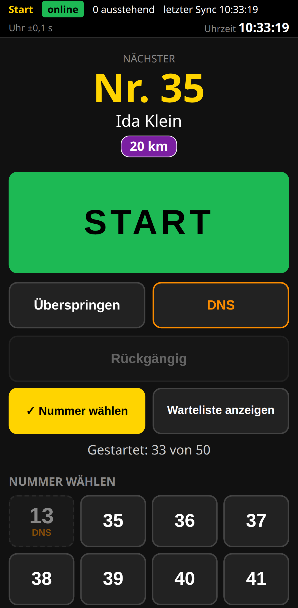
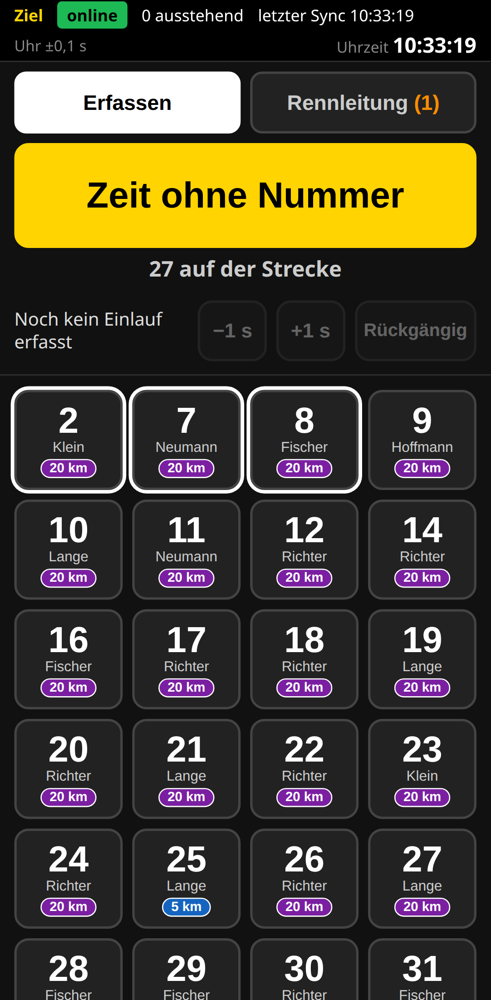

# TapTrial – Zeitnahme per Handy

TapTrial ist eine Web-App für die **Zeitnahme bei Einzelzeitfahren** – gedacht für Vereine ohne Chip-Zeitnahme. Start, Ziel, Zwischenzeiten und Rennleitung laufen auf Handys oder Tablets im Browser, die Ergebnisse stehen sofort online und auf einem Zielmonitor. Keine Chips, keine Lichtschranke, kein App-Store.

| Start | Ziel | Zielmonitor | Ergebnisse |
|---|---|---|---|
|  |  |  |  |

## Was TapTrial kann

- **Start und Ziel per Tipp:** Der Starter tippt beim Losfahren, der Zielrichter beim Zieleinlauf auf die Startnummer (oder stempelt erst und ordnet später zu). Zeiten in Zehntelsekunden.
- **Offline-fest:** Jedes Gerät speichert seine Zeiten zuerst lokal und überträgt sie, sobald Netz da ist. Ein Funkloch kostet keine Zeit.
- **Nichts geht verloren:** Alle Zeitdaten sind Ereignisse, die nie gelöscht oder überschrieben werden; jede Korrektur steht mit Notiz im Protokoll.
- **Rennleitung:** offene Zeiten zuordnen, Zeiten korrigieren, DNS/DNF/DSQ (auch vorläufig), Plausibilitätsprüfung, Aufgabenliste.
- **Mehrere Strecken, Zwischenzeiten und Runden** mit eigenen Posten-Geräten, Ranglisten je Abschnitt.
- **Klassen und Wertung** als Vorlagen (mitgeliefert: Altersklassen und Leistungswertung des Deutschen Radsportabzeichens), anpassbar und als Datei austauschbar.
- **Öffentlich:** Ergebnisse (Seite, Druck, CSV) und ein Zielmonitor für den Großbildschirm, beides ohne Anmeldung; QR-Code „Ergebnisse aufs Handy“.
- **Admin** mit geführter Einrichtung, Gerätelinks als QR-Codes, Urkunden, Papier-Protokoll als Rückfallebene, Abschließen, Anonymisieren, restloses Löschen.
- Kurzanleitungen je Gerät (je eine DIN-A4-Seite) und Admin-Handbuch direkt in der App.

## Was TapTrial bewusst nicht kann

- Keine Chip-, RFID- oder Lichtschranken-Zeitnahme – die Genauigkeit hängt am Tipp (typisch einige Zehntel).
- Keine Online-Anmeldung, keine Bezahlung, kein E-Mail-Versand.
- Ausgelegt für **einen Verein** und kleine Felder (bis etwa 100 Fahrer); Mandanten, Wellen- und Massenstart stehen in der [Roadmap](ROADMAP.md).
- Kein Ersatz für offizielle Nachweise (z. B. Radsportabzeichen: Prüfer und Unterschrift bleiben nötig).

## Schnellstart mit dem fertigen Image

Voraussetzung: ein Rechner oder Server mit Docker und Docker Compose.

```bash
mkdir taptrial && cd taptrial
# docker-compose.yml, docker-compose.caddy.yml, Caddyfile und .env.example aus diesem Repository holen
cp .env.example .env          # TAPTRIAL_TOKEN_ADMIN setzen: openssl rand -base64 32
docker compose up -d          # http://localhost:8000
```

**Mit HTTPS (empfohlen, für den Renntag nötig):** Domain auf den Server zeigen lassen, Ports 80 und 443 freigeben, in `.env` `TAPTRIAL_DOMAIN` eintragen, dann

```bash
docker compose -f docker-compose.caddy.yml up -d     # https://<eure-domain>
```

Caddy holt das Zertifikat selbst. **Wichtig: Ohne HTTPS gibt es keinen Offline-Betrieb und keine installierbare App (PWA) auf den Handys** – Browser erlauben Service Worker nur über HTTPS (Ausnahme: `localhost`).

Danach im Browser `/admin` öffnen, mit der Admin-Passphrase anmelden und „Neue Veranstaltung einrichten“ wählen. Das Admin-Handbuch steht in der App unter „Hilfe“.

## Selbst bauen

```bash
docker build --build-arg VERSION="$(sed -n 's/^version = "\(.*\)"/\1/p' pyproject.toml)" -t taptrial .
```

Die Version kommt aus `pyproject.toml` und wird als Build-Argument `VERSION` übergeben; ohne sie bricht der Build mit einer Meldung ab.

Ohne Docker (Entwicklung): Python 3.12 und [uv](https://docs.astral.sh/uv/), dann

```bash
uv sync
TAPTRIAL_TOKEN_ADMIN=geheim uv run uvicorn app.main:app --reload    # http://localhost:8000
uv run pytest -q                                                # Tests (E2E: uv run playwright install chromium)
```

## Konfiguration

Alle Einstellungen kommen aus Umgebungsvariablen (Vorlage: [.env.example](.env.example)). Vereinsname, Impressum und Datenschutz stellt ihr im Admin unter „Vorlagen“ ein.

| Variable | Pflicht | Bedeutung |
|---|---|---|
| `TAPTRIAL_TOKEN_ADMIN` | ja | Admin-Passphrase. Ohne sie startet die App nicht (Meldung im Log). |
| `TAPTRIAL_DOMAIN` | mit Caddy | Domain für HTTPS (`docker-compose.caddy.yml`). |
| `TAPTRIAL_VERSION` | nein | Image-Version für Compose (Standard `latest`). |
| `TAPTRIAL_PORT` | nein | Port ohne Caddy (Standard 8000). |
| `TAPTRIAL_VERTRAUTE_PROXYS` | nein | Proxys, deren `X-Forwarded-*` ausgewertet werden (Standard `127.0.0.1,::1`, passt für Caddy). |
| `TAPTRIAL_KLASSEN_DATEI`, `TAPTRIAL_WERTUNGEN_VERZEICHNIS` | nein | Andere Altersklassen bzw. Wertungen für den ersten Start. |
| `TAPTRIAL_DB_PFAD` | nein | Nur ohne Docker: Pfad der SQLite-Datei (im Image fest `/data/zeitfahren.sqlite3`). |

Ältere Installationen nutzen noch die Namen `RCB_…` (z. B. `RCB_TOKEN_ADMIN`). Sie gelten weiter; ist beides gesetzt, gewinnt `TAPTRIAL_…`. Beim Start steht dann einmal je Variable der Hinweis „veraltet“ im Log – umbenennen genügt.

## Sicherung und Wiederherstellung

Alle Daten liegen in einer SQLite-Datei im Volume `taptrial-daten`. Eine konsistente Sicherung geht auch während des Rennens:

```bash
docker compose exec app python -m app.verwaltung backup /data/sicherung.sqlite3
docker compose cp app:/data/sicherung.sqlite3 ./sicherung-$(date +%F).sqlite3
```

Zurückspielen (App vorher stoppen):

```bash
docker compose stop app
docker compose run --rm --no-deps -v "$PWD":/backup --entrypoint sh app -c \
  "cp /backup/sicherung-JJJJ-MM-TT.sqlite3 /data/zeitfahren.sqlite3 && rm -f /data/zeitfahren.sqlite3-wal /data/zeitfahren.sqlite3-shm"
docker compose start app
```

## Update

```bash
docker compose pull && docker compose up -d      # bzw. mit -f docker-compose.caddy.yml
```

Die Datenbank wird beim Start automatisch angepasst. Vorher eine Sicherung ziehen. Was sich geändert hat, steht im [CHANGELOG](CHANGELOG.md); die laufende Version zeigt `/version`.

## Ausprobieren

Eine fertig gefahrene Demo-Veranstaltung (Teilnehmer, Strecken mit Zwischenzeiten, offizielles Ergebnis) legt dieser Befehl an; ansehen im Admin oder unter `/ergebnisse?veranstaltung=<ID>`, zum Durchspielen dort aktiv setzen:

```bash
docker compose exec app python -m app.verwaltung demo          # ohne Docker: uv run python -m app.verwaltung demo
```

## Hinweis zur Genehmigung

Hinweis: Auf öffentlichen Straßen ist für Veranstaltungen mit Zeitnahme in der Regel eine Erlaubnis nach § 29 StVO nötig, auf anderen Flächen die Zustimmung des Eigentümers.

## Lizenz

TapTrial steht unter der [PolyForm Noncommercial License 1.0.0](LICENSE): Nutzung, Änderung und Weitergabe sind für nicht-kommerzielle Zwecke erlaubt, z. B. für Vereine. Fremde Bestandteile: [THIRD_PARTY_LICENSES.md](THIRD_PARTY_LICENSES.md).

Die Software wird **ohne Gewähr** bereitgestellt; es gibt **keine Supportzusage**.

## Mitmachen

Fehlerberichte und Wünsche sind als [Issues](../../issues) willkommen. **Pull Requests nehmen wir derzeit nicht an**, weil dafür die Rechte an Beiträgen geklärt sein müssten (Lizenz). Mehr in [CONTRIBUTING.md](CONTRIBUTING.md), Sicherheitslücken bitte wie in [SECURITY.md](SECURITY.md) beschrieben melden.
