# Admin-Handbuch

**TapTrial – Zeitnahme per Handy.** Für Veranstalter: eine Veranstaltung einrichten, während des Rennens korrigieren und hinterher abschließen. Alles läuft im Browser am Laptop (Tablet und Handy gehen auch). Kurzanleitungen für die Helfer: [Start](START.md), [Ziel](ZIEL.md), [Rennleitung](RENNLEITUNG.md), [Zielmonitor](MONITOR.md).

## 1. Anmelden {#anmelden}

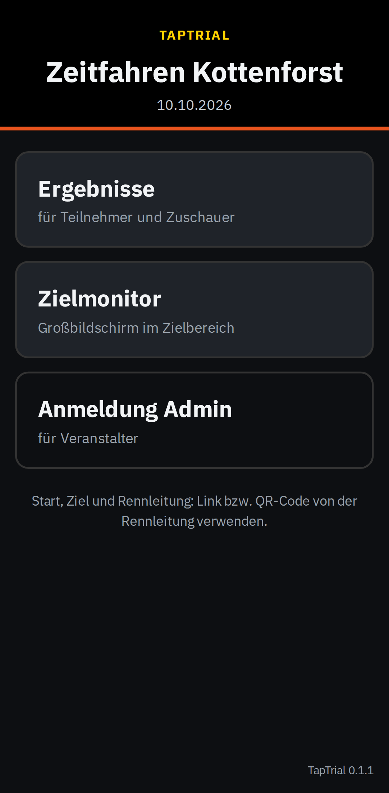

1. Die Adresse eurer Installation öffnen (z. B. **https://zeitnahme.example.org**). Die Startseite zeigt die aktive Veranstaltung und drei Knöpfe: **Ergebnisse**, **Zielmonitor** und **Anmeldung Admin**. Gerätelinks stehen dort bewusst nicht (die gibt es nur im Admin).
2. „Anmeldung Admin“ wählen, die **Admin-Passphrase** eingeben (beim Einrichten als `TAPTRIAL_TOKEN_ADMIN` festgelegt, bei älteren Installationen `RCB_TOKEN_ADMIN`) und „Anmelden“.
3. Die Anmeldung gilt 12 Stunden. Oben rechts „Abmelden“, wenn du fertig bist.

> Nach 5 falschen Eingaben ist die Anmeldung für 15 Minuten gesperrt.

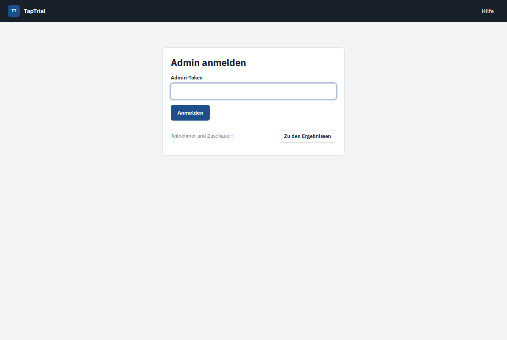

Unter dem Anmeldefeld führt „Zu den Ergebnissen“ zur öffentlichen Ergebnisseite. Teilnehmer und Zuschauer erreichen Ergebnisse und Zielmonitor am einfachsten über die Startseite.

## 2. Aufbau des Admins {#aufbau}

Die **Kopfzeile** hat immer dieselben Knöpfe: **Veranstaltungen** (Liste aller Veranstaltungen), **Vorlagen** (Klassen- und Wertungssätze, Abschnitt 12), **Hilfe** und **Abmelden**. „Hilfe“ öffnet dieses Handbuch im selben Fenster direkt beim Abschnitt zur aktuellen Seite; „Zurück zum Admin“ in der Kopfzeile der Hilfe führt zurück.

In einer geöffneten Veranstaltung steht links die **Seitenleiste** mit allen Seiten, nach Themen gruppiert. Kopfzeile und Seitenleiste bleiben beim Scrollen stehen. Auf dem Handy bleibt nur die Kopfzeile stehen; der Knopf „**Menü**“ darin klappt die Seitenleiste auf. Ganz unten in der Seitenleiste steht klein die Version der App (auf dem Handy unten im aufgeklappten Menü); auf den öffentlichen Seiten und in der Hilfe steht sie klein rechts in der Fußzeile neben Impressum und Datenschutz. Alle Punkte sind immer sichtbar; was im aktuellen Zustand nicht geht, ist auf der Seite gesperrt und nennt den Grund.

| Gruppe | Seite | Inhalt |
|---|---|---|
| – | **Übersicht** | Kennzahlen, „Als Nächstes“ (Aufgabenliste mit Buttons), Stand |
| Veranstaltung | **Einstellungen** | Reiter Allgemein, Klassen & Wertung, Zielmonitor und Ergebnisse |
| | **Strecken** | Liste der Strecken, Klassenzuordnung; je Strecke ein Editor (Grunddaten, Verlauf, Auswertungsabschnitte) |
| | **Messpunkte** | Start, Zwischenzeiten und Ziel der Veranstaltung mit nutzenden Strecken und Gerätestatus |
| | **Teilnehmer** | Liste mit Suche und Filtern; CSV importieren; hinzufügen; Zeile öffnet den Fahrer |
| Zeitnahme | **Geräte** | Gerätelinks mit QR-Code, verbundene Geräte und Uhren, Zugang sperren |
| | **Aufgaben** | Konflikte, offene Zeiten, vorläufige DSQ, Hinweise – jeder Fall direkt lösbar; Zahl offener Aufgaben in der Seitenleiste |
| | **Protokoll** | alle Einträge, Filter, Gerätedatei einlesen, CSV |
| Auswertung | **Ergebnis** | Ergebnistabelle, offiziell erklären bzw. zurücknehmen |
| | **Drucken & Export** | alle Ausdrucke und Dateien an einem Ort |
| Verwaltung | **Status & Datenschutz** | aktiv setzen, abschließen, anonymisieren, löschen |

Jedes Formular zum Anlegen oder Bearbeiten hat neben „Speichern“ den Knopf **„Abbrechen“**: ohne Speichern zurück zur Seite, von der man kam (bzw. zur passenden Liste); in aufgeklappten Formularen (z. B. „Manuelle Zeit eintragen“) klappt er das Formular zu und verwirft die Eingaben. Detailseiten (Fahrer) haben oben „Zurück“ zur Liste. Jede Seite hat **höchstens eine Reiter-Ebene**; Editoren mit mehreren Reitern (Strecken-Editor) haben unten eine zentrale **Aktionsleiste** mit „Alles speichern“, „Abbrechen“ und „Zurück“.

Jede Seite hat oben einen Titel, einen Satz Erklärung und rechts die Aktionen. Es gibt vier Arten von Buttons: **Primär** (blau, höchstens einer je Bereich), **Sekundär** (blauer Rahmen), **Ruhig** (grauer Rahmen) und **Gefahr** (rot). Ein „…“ am Ende heißt: es folgt eine Bestätigung. Absicherung überall gleich: **nicht umkehrbare** Aktionen fragen nach dem Namen der Veranstaltung, **umkehrbare** (z. B. Token erneuern, offiziell erklären) mit einem Dialog, **Korrekturen an Zeiten** verlangen eine Notiz und stehen im Protokoll.

Lange Tabellen scrollen in ihrem eigenen Bereich, die Kopfzeile der Tabelle bleibt dabei stehen. Ein Klick auf eine Zeile öffnet das Objekt (z. B. den Fahrer).

## 3. Neue Veranstaltung mit dem Assistenten einrichten {#einrichtung}

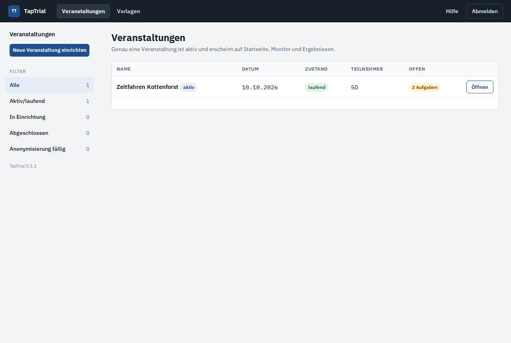

Unter „Veranstaltungen“ → „**Neue Veranstaltung einrichten**“ (oben in der Seitenleiste) startet der Assistent. Oben zeigt eine Fortschrittsanzeige die fünf Schritte; mit „Zurück“/„Weiter“ blätterst du, erledigte Schritte sind anklickbar.

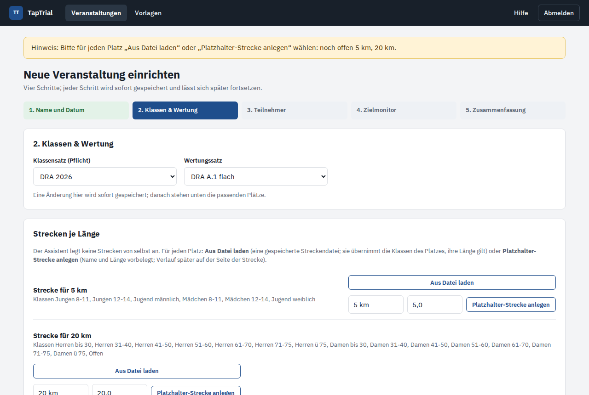

1. **Name und Datum.** „Weiter“ legt die Veranstaltung an – noch **nicht aktiv**.
2. **Klassen & Wertung:** Klassensatz wählen, optional einen dazu passenden Wertungssatz, eine Änderung dort wird sofort gespeichert. Der Assistent legt **keine Strecken von selbst an**: Unter „**Strecken je Länge**“ steht je Längen-Platz aus dem Wertungssatz eine Zeile, z. B. „Strecke für 5 km – Klassen Jungen 8-11, …“ (ohne Längen im Satz eine Zeile „Strecke für alle Klassen“). Für jeden Platz wählst du „**Aus Datei laden**“ (speichert den Schritt, öffnet „Strecke aus Datei laden“ und kehrt danach hierher zurück; die geladene Strecke übernimmt die Klassen des Platzes; weicht ihre Länge ab, gilt die Datei und der Platz zeigt einen Hinweis) oder „**Platzhalter-Strecke anlegen**“ (Name und Länge vorbelegt, änderbar). Jeder Platz zeigt die **tatsächliche Klassenzuordnung** (eine Umordnung unter „Strecken“ erscheint sofort) und hat „**Ändern**“ (bis zur ersten Zeit): erneut aus Datei laden oder Platzhalter anlegen; die bisher gewählte Strecke fällt weg, wenn sie danach keine Klassen mehr hat, sonst bleibt sie mit Hinweis. Erst wenn für jeden Platz entschieden ist, geht „**Weiter**“ (die Streckenlängen prüft er beim Weitergehen); dann folgt **Strecken & Zuordnung** (Abschnitt 5a). Fehler (z. B. fehlende Länge) zeigt er sofort an. Je Strecke wählst du „**einfach** (nur Start und Ziel)“ – wie bisher – oder „**mit Zwischenzeiten**“: Dann speichert „**Zwischenzeiten einrichten**“ diesen Schritt und öffnet die Seite der Strecke im Reiter „Verlauf“ (Abschnitt 5a.3); „Zurück zum Assistenten“ führt mit erhaltenem Fortschritt zurück. „**Strecke aus Datei laden**“ geht auch direkt hier (Abschnitt 5a.4). Wählst du bei einer Strecke mit Verlauf wieder „einfach“, fragt ein **Bestätigungsdialog** „Verlauf und Abschnitte von ‚<Name>‘ werden gelöscht“: „Löschen“ entfernt sie beim Weiter (die Zwischenzeiten bleiben), „Abbrechen“ stellt „mit Zwischenzeiten“ wieder ein.
3. **Teilnehmer:** CSV hochladen (mit Vorschau, Abschnitt 4) oder einzeln anlegen. Teilnehmer lassen sich auch später ergänzen.
4. **Zielmonitor:** dieselben Bausteine wie unter Einstellungen → „Zielmonitor und Ergebnisse“ (Seiten, Reihenfolge, Dauer, Live-Bereich, Abschnittsfelder, Abschnitt 5.2) mit einer Vorgabe, die du nur bestätigen musst: Ergebnisseite an, Live-Bereich an, je Abschnitt (Segmente, Rundenblöcke, eigene) ein Feld, „mit Pfeil und Differenz“ bei Abschnitten mit mehreren Durchfahrten. „**Vorschau**“ öffnet den Monitor in einem neuen Tab; „Weiter“ speichert.
5. **Zusammenfassung:** alle Angaben auf einen Blick, Gerätelinks mit QR-Codes. „als aktive Veranstaltung setzen“ angekreuzt lassen und „**Einrichtung abschließen**“.

Jeder Schritt wird sofort gespeichert. Wer den Assistenten verlässt, findet in der Liste „in Einrichtung · Schritt n/4“ und den Button „Einrichtung fortsetzen“.

Es gibt immer genau **eine aktive** Veranstaltung (die Datenbank lässt keine zweite zu) – sie erscheint auf der Startseite, den öffentlichen Seiten und im Monitor. Eine andere Veranstaltung später aktiv setzen: Veranstaltung öffnen → „Status & Datenschutz“ → „Als aktive Veranstaltung setzen …“.

### Liste der Veranstaltungen {#veranstaltungen}

Die Seite „Veranstaltungen“ hat eine Seitenleiste: oben „Neue Veranstaltung einrichten“, darunter Filter mit Anzahl – **Alle**, **Aktiv/laufend**, **In Einrichtung**, **Abgeschlossen** (auch anonymisierte), **Anonymisierung fällig**. Die Liste zeigt die Veranstaltungen des gewählten Filters mit Datum, Zustand, Teilnehmerzahl und offenen Aufgaben; ein Klick öffnet die Veranstaltung. Oben steht ein Hinweis, wenn eine Anonymisierung fällig ist.

### Freigabe der Zeitnahme {#freigabe}

Starten, Zielzeiten, Durchfahrten, Status, Korrekturen und Gerätedateien gehen erst, wenn die Zeitnahme **freigegeben** ist: **Einrichtung abgeschlossen** (letzter Schritt des Assistenten) **und** Veranstaltung **aktiv**. Vorher zeigen Start, Ziel, Rennleitung und Posten statt der Bedienung „**Zeitnahme noch nicht freigegeben**“ mit den fehlenden Schritten und schalten sich danach von selbst frei; der Server lehnt Zeiten ab, das Gerät behält sie und sendet sie nach der Freigabe. Auch manuelle Zeiten und Korrekturen im Admin sind bis dahin gesperrt. Öffentlich zeigen Ergebnisse und Monitor für eine solche Veranstaltung ohne Zeiten „Für diese Veranstaltung gibt es noch keine Ergebnisse.“ (die Vorschau aus dem Admin zeigt trotzdem alles). Für einen Probelauf eine eigene Testveranstaltung anlegen und danach löschen – einen Probemodus gibt es nicht.

### 3a. Übersicht einer Veranstaltung {#uebersicht}

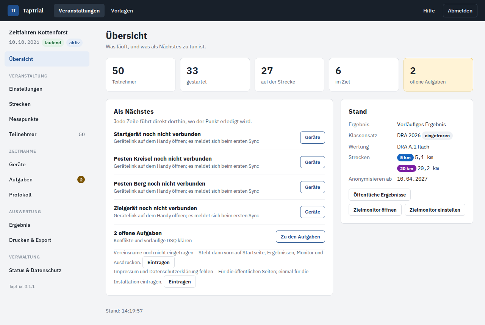

Oben stehen Kennzahlen (Teilnehmer, gestartet, auf der Strecke, im Ziel, offene Aufgaben – ein Klick öffnet die passende Liste). Darunter **„Als Nächstes“**: was gerade zu tun ist, jeweils mit einem Button direkt dorthin. Solange die Zeitnahme **nicht freigegeben** ist, steht oben „Zeitnahme noch nicht freigegeben“ mit den fehlenden Schritten. Die Liste ergibt sich aus dem Zustand, z. B. „Strecke „20 km“: Länge fehlt“, „Noch keine Teilnehmer“, „Veranstaltung ist nicht aktiv“, „Startgerät noch nicht verbunden“ (mit Segmenten auch je Posten, z. B. „Posten Kreisel noch nicht verbunden“), „Gerät ziel-3f2a: Uhr weicht +0,8 s ab“, „2 offene Aufgaben“, „Ergebnis offiziell erklären“, „Veranstaltung abschließen“ oder „Anonymisierung fällig“. Rechts steht der Stand (Ergebnis, Klassensatz, Wertung, Strecken, Anonymisierungsfrist) mit Buttons zu den öffentlichen Ergebnissen und zum Zielmonitor. Die Seite **aktualisiert sich alle 10 Sekunden selbst** (Kennzahlen, „Als Nächstes“, Stand), ohne neu zu laden; darunter steht „Stand: hh:mm:ss“. In einem Tab im Hintergrund ruht die Aktualisierung und holt beim Zurückkehren sofort nach.

## 4. Teilnehmer {#teilnehmer}

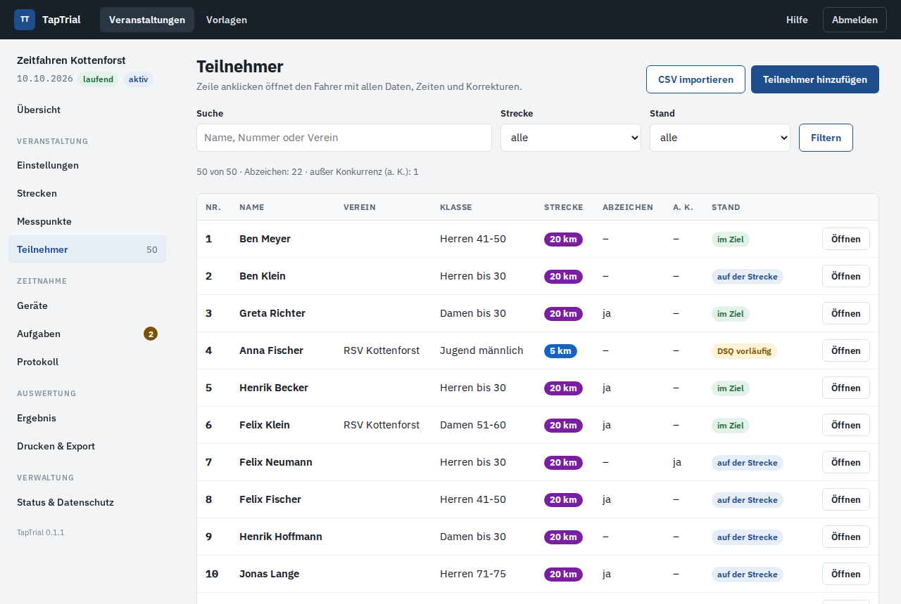

Die Seite „Teilnehmer“ zeigt zuerst die Liste mit **Suche** (Name, Nummer oder Verein) und Filtern nach **Strecke** und **Stand** (noch nicht gestartet, gestartet, auf der Strecke, im Ziel, DNS/DNF/DSQ). Ein Klick auf eine Zeile öffnet den **Fahrer** (Abschnitt 4a). Oben rechts öffnen „**CSV importieren**“ und „**Teilnehmer hinzufügen**“ eigene Seiten. Ohne Teilnehmer steht dort „Noch keine Teilnehmer“ mit denselben Buttons.

**Abzeichen und außer Konkurrenz (a. K.)** stehen in der Liste als Spalte und lassen sich auf der Fahrer-Seite umschalten (ja/nein); jede Änderung steht im Protokoll. Über der Tabelle steht, wie viele Teilnehmer ein Abzeichen wollen und wie viele a. K. fahren. Ist die Leistungswertung aus, gibt es keine Abzeichen-Spalte, nur den Hinweis „Wertung aus“.
- **Außer Konkurrenz:** Die Zeit wird erfasst und angezeigt, mit dem Kennzeichen „a. K.“, aber **ohne Rang**. Die Ränge der anderen bleiben, als wäre der Fahrer nicht dabei. In den Listen steht er nach seiner Zeit einsortiert, ohne Rangnummer.

Nachmeldungen einzeln: „Teilnehmer hinzufügen“. Korrekturen der Daten: Fahrer öffnen → „Daten bearbeiten“ (dort auch „Teilnehmer löschen“, solange es keine Einträge zu der Nummer gibt). Die Startnummer lässt sich nicht mehr ändern, sobald es Zeiten zu ihr gibt.

### CSV importieren mit Vorschau {#import}

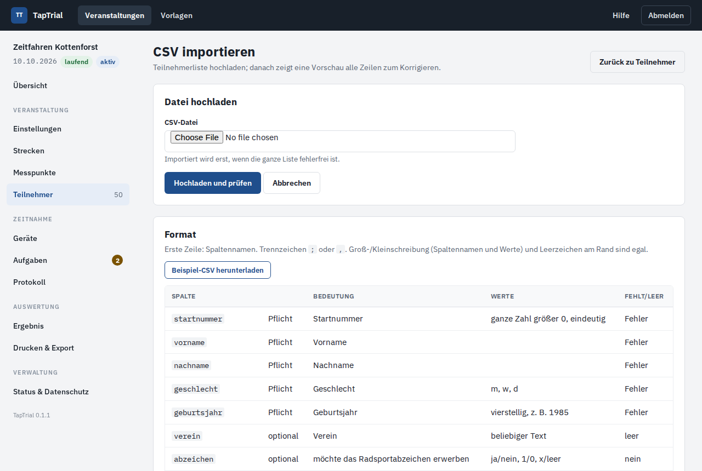

Die Teilnehmerliste als CSV-Datei (z. B. aus Excel „Speichern unter → CSV (Trennzeichen-getrennt)“). Die Seite „CSV importieren“ zeigt alle Spalten mit erlaubten Werten und bietet eine **Beispiel-CSV zum Herunterladen** – am einfachsten diese als Vorlage nehmen. Erste Zeile sind die Spaltennamen:

```
startnummer;vorname;nachname;geschlecht;geburtsjahr;verein;abzeichen;ausser_konkurrenz
1;Anna;Becker;w;1990;RC Bonn;ja;
2;Ben;Fischer;m;1985;;;
3;Kim;Lange;d;1979;RSV Kottenforst;x;ja
```

- **Geschlecht:** `m`, `w` oder `d`. **Geburtsjahr** vierstellig. **Verein** darf leer bleiben.
- **abzeichen** (optional): möchte das Radsportabzeichen erwerben. **ausser_konkurrenz** (optional): fährt mit, bekommt aber keinen Rang. Werte `ja`/`nein`, `1`/`0` oder `x`/leer; fehlt die Spalte oder ist das Feld leer, gilt „nein“.
- Groß- und Kleinschreibung ist egal – bei Spaltennamen und Werten (`JA`, `Ja`, `X`, `M`, `W` …); Leerzeichen am Anfang/Ende werden ignoriert.
- Trennzeichen Semikolon oder Komma; Umlaute aus Excel funktionieren.
- Die Altersklasse berechnet die App selbst (Deutsches Radsportabzeichen, Alter = Wettkampfjahr − Geburtsjahr). `d` kommt in die Wertung „Offen“.

Datei wählen und „**Hochladen und prüfen**“. Es folgt die **Vorschau**:

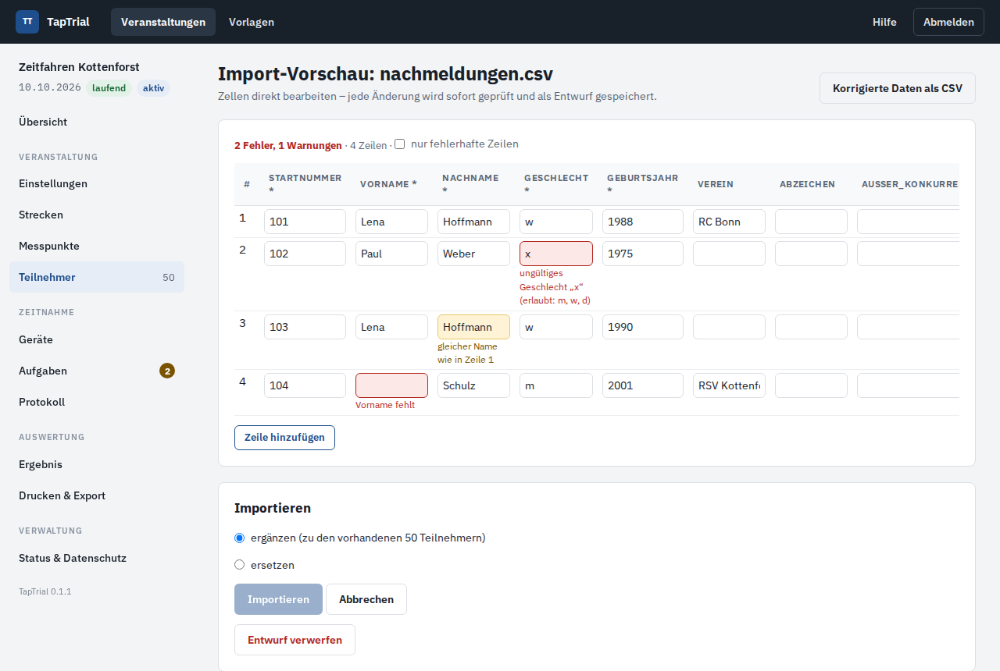

- Jede Zeile der Datei steht in einer Tabelle. **Fehler** sind rot markiert, mit Text direkt an der Zelle (z. B. doppelte Startnummer, ungültiges Geschlecht, fehlender Vorname, keine passende Altersklasse). **Warnungen** sind gelb (z. B. gleicher Name zweimal) – sie verhindern den Import nicht.
- Oben steht der Zähler „N Fehler, M Warnungen“; „nur fehlerhafte Zeilen“ blendet den Rest aus.
- **Zellen direkt korrigieren**, Zeilen mit × löschen oder „Zeile hinzufügen“ – die Prüfung läuft sofort neu.
- Der Entwurf wird auf dem Server gespeichert: Neu laden oder später weitermachen verliert nichts („offener Import-Entwurf“ unter „Teilnehmer“). „Korrigierte Daten als CSV“ liefert die bereinigte Datei.
- „**Importieren**“ ist erst aktiv, wenn es keine Fehler mehr gibt. Wahl: **ergänzen** (zu den vorhandenen Teilnehmern) oder **ersetzen** (löscht vorher die bisherige Liste – mit Warnung und Bestätigung; die Warnung nennt, wie viele Teilnehmer seit dem letzten Import im Admin angelegt oder geändert wurden – diese Änderungen gingen verloren).
- „Entwurf verwerfen“ bricht ab, ohne etwas zu übernehmen.

### 4a. Fahrer-Seite {#fahrer}

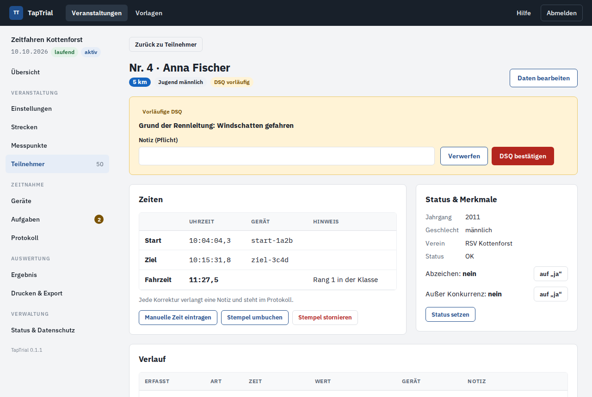

Alles zu einem Fahrer auf einer Seite: Kopf mit Nummer, Name, Strecke, Klasse und Stand (z. B. „im Ziel“, „Zeit korrigiert +1,0 s“), Buttons „Urkunde“ (nur mit gültiger Zeit) und „Daten bearbeiten“.

- **Zeiten:** alle gültigen Stempel des Fahrers mit Uhrzeit, Gerät und Hinweis (korrigiert, manuell), darunter Fahrzeit, Rang in der Klasse und ggf. Abzeichen. Aktionen: **Manuelle Zeit eintragen** (Uhrzeit hh:mm:ss,z von Handstoppuhr/Video oder bei der Zielzeit eine Fahrzeit mm:ss,z; wird als „manuell“ markiert), **Stempel umbuchen** (auf eine andere Nummer oder Zuordnung aufheben), **Stempel stornieren**. Jede Korrektur verlangt eine Notiz und steht im Protokoll; danach bleibt man auf der Fahrer-Seite.
- **Status & Merkmale:** Jahrgang, Geschlecht, Verein, Status; Abzeichen und a. K. umschalten; **Status setzen** (DNS, DNF, DSQ endgültig, OK = Status aufheben).
- **Vorläufige DSQ:** Hat die Rennleitung „DSQ vorläufig“ gesetzt, steht der Fall mit Grund oben und lässt sich direkt bestätigen oder verwerfen (Notiz Pflicht).
- **Segmente** (nur mit Segmenten, Abschnitt 5a.3): Tabelle **Durchfahrten** – jede Durchfahrt des Fahrers mit Uhrzeit, Zeit seit dem Start, Gerät (Herkunft) und Zuordnung zur Abfolge (z. B. „3. · Kreisel (2)“), dazu erwartete, aber nicht erfasste Durchfahrten („nicht erfasst – ohne Folgen für die Wertung“) und Tipps, die nicht zählen („nicht gezählt: Doppeltipp“ mit „Doch werten“, „am Ziel“, „nicht in der Abfolge“). Eine falsche Durchfahrt lässt sich mit Notiz **stornieren**. Darunter die **Abschnittszeiten** (sichtbare Segment-Abschnitte und eigene) je Durchfahrt, ab der zweiten Durchfahrt mit „▼ schneller“/„▲ langsamer“ als die Durchfahrt davor.
- **Verlauf:** alle Einträge zu dieser Nummer aus dem Protokoll (stornierte durchgestrichen).

## 5. Einstellungen {#einstellungen}

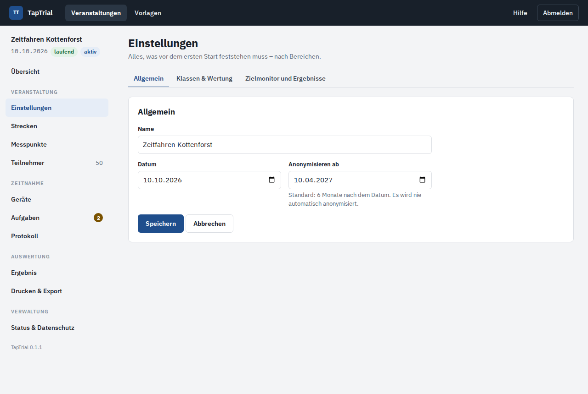

Die Seite „Einstellungen“ hat drei **Reiter** (Allgemein · Klassen & Wertung · Zielmonitor und Ergebnisse), jeder mit eigener Adresse, eigenem „Speichern“ und eigenem Hilfe-Abschnitt; auf dem Handy lässt sich die Reiterleiste waagerecht schieben. Was nicht mehr geändert werden kann, ist gesperrt und nennt den Grund (z. B. „es gibt bereits Zeiten“).

**Allgemein:** Name, Datum und Anonymisierungsfrist (Standard 6 Monate nach dem Datum, es wird nie automatisch anonymisiert). „Ziel und Rennleitung auf einem Gerät umschaltbar“ steht jetzt auf der Karte des jeweiligen Ziels unter „Geräte“ (Abschnitt 6).

> Mit der **ersten Zeit** (auch beim Testlauf) werden Klassensatz und Wertungssatz für diese Veranstaltung **eingefroren**: Es gilt dann eine Kopie, spätere Änderungen an den Vorlagen wirken nicht mehr. Die Seite zeigt „Eingefroren seit …“; der Klassensatz ist dann gesperrt. Den Wertungssatz kann man bewusst noch umstellen oder ausschalten (dafür muss jede Strecke vorher eine gemessene Länge haben). Ebenso eingefroren: Strecken hinzufügen/entfernen, Klassenzuordnung, Messpunkte und Streckenverlauf; Namen und gemessene Längen bleiben änderbar (Länge bis „Ergebnis offiziell“), Auswertungsabschnitte ebenso.

### 5.1 Klassen & Wertung {#klassen-wertung}

- **Klassensatz** (Pflicht): welche Altersklassen gelten, Standard ist „DRA 2026“ (Deutsches Radsportabzeichen). Eigene Sätze siehe Abschnitt 12.
- **Wertungssatz** (optional, **Leistungswertung**): Angeboten werden nur Wertungssätze, die zum gewählten Klassensatz gehören, plus „keine Wertung“ (= Leistungswertung aus). Wechselt man den Klassensatz, wird eine nicht passende Wertung **zurückgesetzt** und ein Hinweis angezeigt.
- **Satzwechsel legt keine Strecken an:** Ändert sich Klassen- oder Wertungssatz (vor der ersten Zeit), bleiben die Strecken samt gemessenen Längen. Klassen, die es nicht mehr gibt, fallen aus der Zuordnung; neue Klassen gehen an die Strecke passender Länge (sonst an die letzte) – die Seite nennt sie, bitte unter „Strecken“ prüfen. Fehlt eine Länge (z. B. 5 km für die Jugend), dort „Strecke hinzufügen“ oder „Aus Datei laden“. Braucht die Wertung eine Länge, die einer Strecke fehlt, sagt die Seite das.
- Hat eine Klasse keinen Eintrag im Wertungssatz, erscheint ein Hinweis (in dieser Klasse gibt es keine Stufe). Bei eingeschalteter Wertung erscheinen Gold/Silber/Bronze in Rennleitung, Monitor, Ergebnissen und Export – nur für Teilnehmer mit „Abzeichen: ja“; „keine Wertung“ blendet die Wertung überall aus.

### 5.2 Zielmonitor und Ergebnisse {#zielmonitor-ergebnisse}

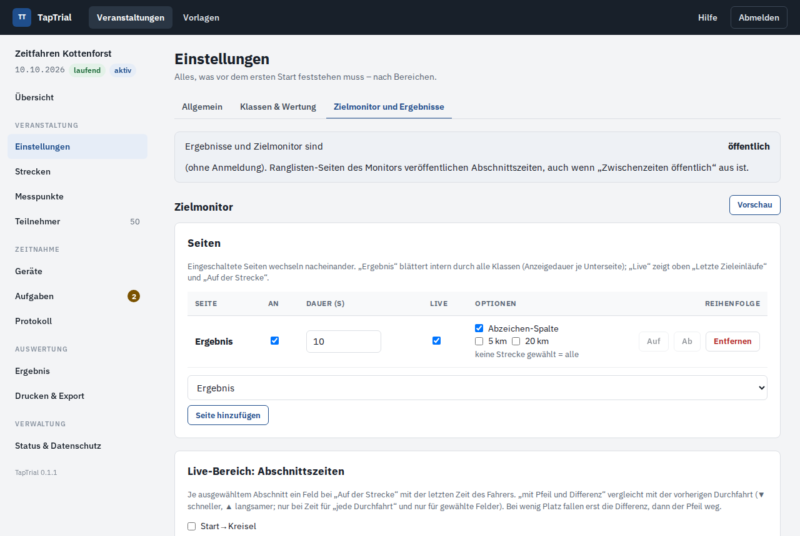

Der Reiter hieß früher „Zielmonitor und Ergebnisse“; die alte Adresse leitet weiter. Reihenfolge: Zielmonitor → Live-Bereich → Zwischenzeiten öffentlich → Ergebnistabelle. Ein Hinweis oben erinnert daran: Ergebnisse und Zielmonitor sind **öffentlich**; Ranglisten-Seiten des Monitors veröffentlichen Abschnittszeiten auch dann, wenn „Zwischenzeiten öffentlich“ aus ist.

#### Zielmonitor {#zielmonitor}

In der Übersicht auch über „Zielmonitor einstellen“ bzw. „Zielmonitor öffnen“ erreichbar:
- **Seiten:** Liste mit „An“, **Anzeigedauer** in Sekunden und Reihenfolge („Auf“/„Ab“); „Seite hinzufügen“ wählt den Typ. Eingeschaltete Seiten wechseln nacheinander. **Ergebnis** ist der Ergebnisbereich (nach Klasse gruppiert, blättert nur, wenn er nicht passt; Dauer je Unterseite); Optionen: Abzeichen ja/nein (nur mit Wertung), Strecke(n) (keine gewählt = alle). **Rangliste Abschnitt**: die Rangliste eines Abschnitts (Auswahl), **Top N** einstellbar (Standard 10).
- **Aufbau am Bildschirm:** Kopfleiste (Veranstaltung, Ergebnisstand, Kennzahlen, QR), ein Spaltenkopf und ein gemeinsames Raster für alle Bereiche (Platz · Nr. · Name · Klasse · Abschnitt · Zeit · Abz./Status). Alle Zeilen teilen sich die Höhe (Zeilenhöhe 4–6 % der Bildschirmhöhe, die Schrift wächst mit): wenige Fahrer – große Schrift; erst wenn es nicht mehr passt, blättert ein Bereich (mindestens 3 Zeilen je Seite). Unter 1200 px Breite fehlt die Spalte Klasse, unter 900 px steht der Abschnitt unter dem Namen.
- **Live:** je Seite abschaltbar; der Live-Bereich („Auf der Strecke“, darunter „Letzte Zieleinläufe“) steht über dem Ergebnis; beide zeigen alle Fahrer (zu viele: Bereich blättert alle 10 s, leer: ausgeblendet).
- **Live-Bereich: Abschnittszeiten:** je angekreuztem Abschnitt ein Feld in der Spalte „Abschnitt“ bei „Auf der Strecke“ mit der letzten Zeit des Fahrers, z. B. „Runde (2) 9:58 ▼ 12 s“ (mehrere Felder: Name klein darüber); im Ergebnis zeigt die Spalte die beste Zeit des ersten angekreuzten Abschnitts mit mehreren Durchfahrten, z. B. „beste Runde 9:18“; je Feld „**mit Pfeil und Differenz**“ (nur bei Zeit für „jede Durchfahrt“; ist der Abschnitt nicht angekreuzt, ist es abgewählt und gesperrt, beim Ankreuzen wieder frei mit der Vorgabe des Assistenten) vergleicht mit der vorherigen Durchfahrt – bei wenig Platz kürzt sich der Name, und erst die Differenz, dann der Pfeil fallen weg; die Zeit bleibt. Ein offener Monitor lädt sich nach einem Update der App selbst neu.
- In der Auswahl stehen **alle sichtbaren Abschnitte**: Segmente, Rundenblöcke und eigene Abschnitte (Abschnitt 5a.1).
- **Speichern** (oder Enter in einem Feld) übernimmt alles. Eine offene **Vorschau** im selben Browser zeigt den neuen Stand sofort, ein laufender Monitor beim nächsten Abruf (spätestens nach 5 s), ohne Neuladen – auch im laufenden Rennen, wenn sich die Ranglisten ständig ändern.
- **Vorschau** öffnet den Monitor dieser Veranstaltung in einem neuen Tab. Ohne eigene Einstellung zeigt der Monitor wie bisher eine Ergebnisseite mit Live-Bereich.

#### Ergebnisse {#ergebnistabelle}

- **Zwischenzeiten öffentlich:** Segment- und Abschnittszeiten (Spalten und Ranglisten) in den öffentlichen Ergebnissen, im Druck und in der öffentlichen CSV; im Admin stehen sie immer.
- **Ergebnistabelle (Seite, Druck, CSV):** je Strecke eine Tabelle aller Abschnitte (Segmente, Rundenblöcke, eigene) mit „**anzeigen**“ – angekreuzte erscheinen als Spalte in Ergebnis, Druck und CSV. Bei mehreren Strecken wählst du oben „Strecke“; der Wechsel verwirft nichts, ein „Speichern“ sichert alle Strecken. Auch nach der ersten Zeit änderbar.

## 5a. Strecken und Messpunkte {#strecken-messpunkte}

Strecken und Messpunkte haben eigene Punkte in der Seitenleiste (Gruppe „Veranstaltung“, zwischen „Einstellungen“ und „Teilnehmer“). Die frühere Adresse des Reiters „Strecken“ unter den Einstellungen leitet auf die Seite „Strecken“ weiter, die Adresse der zwischenzeitlichen Seite „Orte“ auf „Messpunkte“.

### 5a.1 Strecken {#strecken}

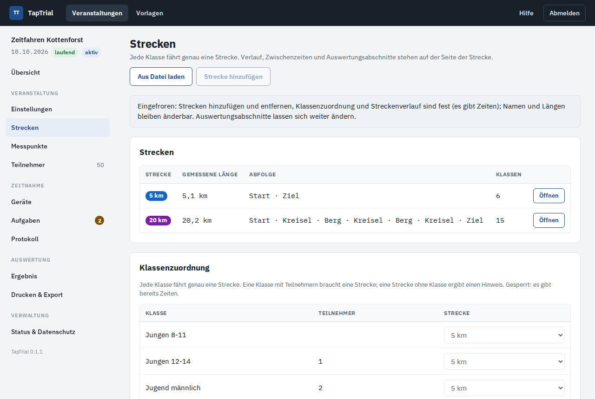

- **Liste:** je Strecke Kennzeichen, gemessene Länge, Abfolge kurz und Zahl der Klassen; „**Öffnen**“ führt auf die Seite der Strecke (5a.3). Oben „**Strecke hinzufügen**“ (legt „Strecke n“ an und öffnet sie) und „**Aus Datei laden**“ (5a.4).
- **Klassenzuordnung:** eine Tabelle für alle Strecken – je Klasse (mit Teilnehmerzahl) ein Auswahlfeld „Strecke“, darunter „Zuordnung speichern“. Eine Klasse mit Teilnehmern braucht eine Strecke; eine Strecke ohne Klasse ergibt einen Hinweis. Nichts wird stillschweigend umverteilt.
- Eine Veranstaltung kann mehrere Strecken haben (z. B. Jugend 5 km, Erwachsene 20 km); jede **Klasse** fährt genau eine Strecke. Bei mehreren Strecken zeigen Start, Ziel-Kacheln, Posten, Rennleitung, Admin und Ergebnisse die Strecke als farbiges Kennzeichen mit Namen (Blau, Lila, Petrol … – bewusst ohne Rot, Orange, Gelb und Grün); der Zielmonitor zeigt sie neutral. Ränge, a. K., Abzeichen, Druck und CSV sind **je Strecke** getrennt; gestartet wird in einer gemeinsamen Reihenfolge.

### 5a.2 Messpunkte {#messpunkte}

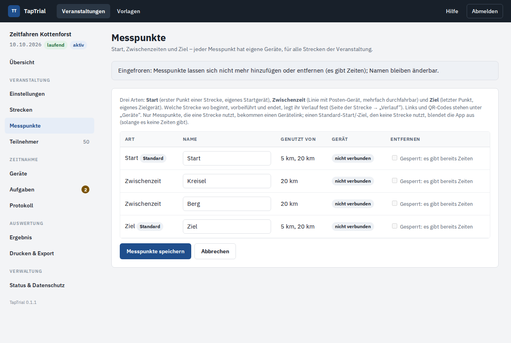

Eigener Punkt „**Messpunkte**“ in der Seitenleiste. Ein Messpunkt hat eine von drei **Arten**:
- **Start** – erster Punkt einer Strecke, mit eigenem Startgerät,
- **Zwischenzeit** – Linie mit eigenem Zeitnehmer (Gerät „Posten“, Abschnitt 6), mehrfach durchfahrbar,
- **Ziel** – letzter Punkt einer Strecke, mit eigenem Zielgerät.

Jede Veranstaltung hat die Messpunkte „**Start**“ (Art Start) und „**Ziel**“ (Art Ziel) (Standard, Kennzeichen „Standard“; umbenennbar) – so arbeitet eine Veranstaltung mit einem Start und einem Ziel wie bisher. Nutzt keine Strecke mehr den Standard (z. B. weil alle Strecken an eigenen Starts „Start 5k“/„Start 20k“ beginnen) und gibt es noch keine Zeiten, blendet die App ihn automatisch aus – auch direkt nach dem Laden der Strecken im Assistenten. Andere Messpunkte, die keine Strecke nutzt, bleiben in der Liste mit dem Kennzeichen „**von keiner Strecke genutzt**“ und lassen sich entfernen. Nur genutzte Messpunkte haben einen Gerätelink. Jede Strecke hat immer einen Start und ein Ziel: Eine neue Strecke beginnt am ersten Start und endet am ersten Ziel der Liste; ein Messpunkt „Start“ bzw. „Ziel“, der neu hinzugefügt wird, ist wieder der Standard mit dem bisherigen Gerätelink. Messpunkte gehören zur **Veranstaltung** und können von mehreren Strecken genutzt werden oder nur von einer. Die Liste zeigt je Messpunkt die Art, den Namen (änderbar), „**Genutzt von**“ (welche Strecken dort beginnen, vorbeiführen bzw. enden) und „**Gerät**“ (verbunden mit Uhrzeit der letzten Meldung bzw. nicht verbunden). Art wählen, „**Messpunkt hinzufügen**“, umbenennen, „Entfernen“ – dann „**Messpunkte speichern**“. Entfernen geht nur, solange keine Strecke den Messpunkt nutzt und es noch keine Zeiten gibt; sonst ist das Kästchen gesperrt und der Grund steht daneben. Die Namen „Start“ und „Ziel“ sind nur für einen Messpunkt der Art Start bzw. Ziel möglich. Ein neuer Messpunkt ist zunächst ungenutzt (Hinweis) und wird danach im Verlauf einer Strecke eingetragen.

### 5a.3 Strecken-Editor {#strecke}

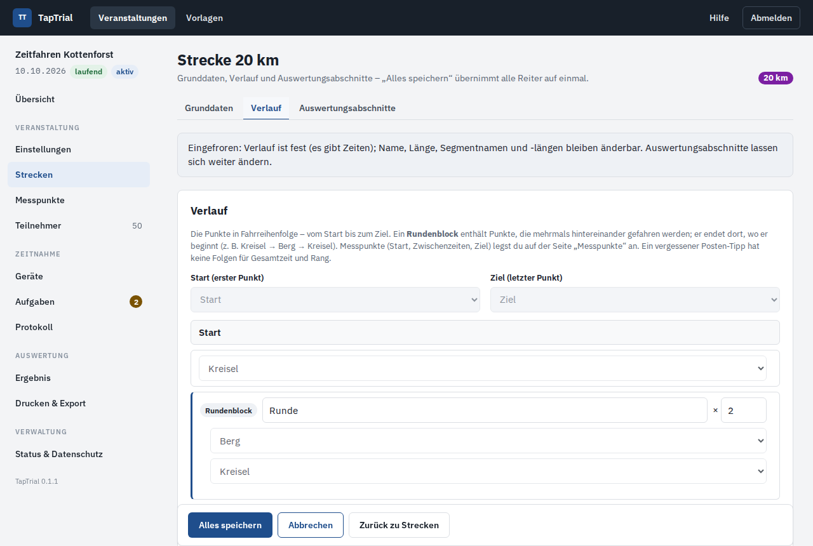

Ein Editor mit drei **Reitern** – **Grunddaten · Verlauf · Auswertungsabschnitte** –, zwischen denen du ohne Speichern wechselst; Eingaben bleiben dabei erhalten. Unten steht immer die **Aktionsleiste**:
- **Alles speichern** übernimmt alle drei Reiter auf einmal. Findet die Prüfung einen Fehler, wird nichts gespeichert: Der Reiter mit dem Fehler ist rot markiert und öffnet sich, die Meldung steht oben und – bei Name, Länge oder Komoot-Link – direkt am Feld.
- **Abbrechen** verwirft alle ungespeicherten Änderungen (die Seite zeigt wieder den gespeicherten Stand).
- **Zurück** führt zur Strecken-Liste (bzw. zurück in den Assistenten). Gibt es ungespeicherte Änderungen, fragt die Seite vorher nach.

#### Grunddaten

Name (kurz halten, z. B. „5 km“ – er steht auf jeder Ziel-Kachel) und **gemessene Länge** (z. B. `20,3`; bei eingeschalteter Wertung Pflicht, gewertet wird jeder gegen **seine** Strecke – bei A.1 nur, wenn sie mindestens so lang ist wie verlangt). Welche Klassen die Strecke fahren, steht in der Klassenzuordnung auf der Seite „Strecken“ (5a.1).

#### Verlauf {#segmente}

Der Verlauf ist eine **Punktfolge** in Fahrreihenfolge: oben der **Start**, unten das **Ziel**, dazwischen die Zwischenzeiten, an denen die Strecke vorbeiführt. Start und Ziel wählst du oberhalb der Punktfolge (Standard: „Start“ und „Ziel“); jede Kombination geht – gleicher Start und anderes Ziel, anderer Start und gleiches Ziel oder beides verschieden. Nach der ersten Zeit sind sie fest.
- **Punkt hinzufügen:** neuer Punkt am Ende, Zwischenzeit aus der Liste wählen (Zwischenzeiten legst du auf der Seite „Messpunkte“ an, 5a.2).
- **Rundenblock hinzufügen:** ein Block mit Namen (Vorgabe „Runde“), Anzahl Wiederholungen („ד) und eigenen Punkten („Punkt im Block hinzufügen“). Ein Block beginnt beim Punkt davor und muss dort auch enden, wenn er mehrmals gefahren wird – z. B. nach „Kreisel“ der Block „Runde ×2: Berg · Kreisel“.
- Mit **↑ / ↓** verschiebst du Punkte und Blöcke, **✕** entfernt sie.

Darunter stehen automatisch die **Segmente**, die sich daraus ergeben (je Abschnitt zwischen zwei Punkten eines, z. B. Start→Kreisel, Kreisel→Berg, Berg→Kreisel, Kreisel→Ziel), mit optionalem **Namen** und **Länge** in km. Der Strecken-Editor beschreibt nur die Strecke: Welche Abschnitte als Spalte erscheinen und wo der Zielmonitor vergleicht, steht unter Einstellungen → „Zielmonitor und Ergebnisse“ (5.2). Ganz unten die Vorschau: Abfolge „Start · Kreisel · Berg · Kreisel · Berg · Kreisel · Ziel“ und Durchfahrten je Zwischenzeit (Kreisel 3×, Berg 2×). Alles aktualisiert sich sofort, gespeichert wird mit „Alles speichern“. Geprüft wird: jeder Punkt gewählt, Rundenblöcke enden, wo sie beginnen, Start nur am Anfang, Ziel nur am Ende. Nach der ersten Zeit ist die Punktfolge fest; Namen und Längen bleiben änderbar.

#### Auswertungsabschnitte

Ein Auswertungsabschnitt ist ein Teil der Strecke, für den eine eigene Zeit ermittelt wird – z. B. eine Runde oder eine Bergwertung. **Jedes Segment ist automatisch einer** (nicht löschbar). **Jeder Rundenblock** (mit mehreren Segmenten) ist ebenfalls automatisch einer: Name des Blocks, „jede Durchfahrt“ (je Wiederholung eine Zeit); er steht mit dem Zeichen „Rundenblock“ oben in der Tabelle und lässt sich nicht löschen. Anzeigen und Vergleich stellst du unter „Zielmonitor und Ergebnisse“ ein (5.2). Wertet ein eigener Abschnitt schon genau dasselbe aus, gibt es keinen zweiten – stattdessen ein Hinweis über der Tabelle.

Für einen eigenen Abschnitt („Abschnitt hinzufügen“) wählst du Name, **Anfang** und **Ende** aus Auswahllisten und unter „**Zeit für**“:
- **jede Durchfahrt** – eine Zeit für jede Durchfahrt am Anfang bis zur nächsten am Ende, z. B. „Runde“ = Kreisel bis nächster Kreisel. Anfang und Ende sind Punkte (Start, Zwischenzeit, Ziel). Nur hier kann der Zielmonitor mit der vorherigen Durchfahrt vergleichen (▼ schneller/▲ langsamer, Einstellung am Monitor-Feld).
- **eine bestimmte Durchfahrt** – nur eine Zeit, z. B. die 1. Runde. Anfang und Ende wählst du aus der Abfolge, z. B. „Start“, „Kreisel · 1. Durchfahrt (nach Startsegment)“, „Berg · 1. Durchfahrt“, „Kreisel · 2. Durchfahrt (nach Runde 1)“ … „Ziel“. Einträge am oder vor dem Anfang sind beim Ende nicht wählbar.

Unter dem Namen steht je Abschnitt eine **Vorschau in Worten**, z. B. „Runde: Kreisel → Berg → Kreisel, 2-mal“ oder „1. Runde: Kreisel → Berg → Kreisel, nur die 1. Durchfahrt an Kreisel“; sie folgt sofort jeder Änderung, auch am Verlauf. Geprüft wird, dass Anfang und Ende auf der Strecke liegen und das Ende in der Abfolge nach dem Anfang kommt. Eine Abschnittszeit entsteht nur aus vorhandenen Messungen; Messungen nach einer erkannten fehlenden Durchfahrt zählen nicht (Start und Ziel immer). Ergebnis, Druck und CSV haben je sichtbarem Abschnitt und Durchfahrt eine Spalte; je Abschnitt gibt es eine Rangliste (Abschnitt 8).

Im Reiter „Grunddaten“ unten „**Strecke entfernen**“. Hat die Strecke Klassen, fragt ein Dialog „**Die Klassen von ‚<Name>‘ übernimmt:** [Strecke]“ – erst nach der Wahl einer anderen Strecke wird entfernt; alle Klassen gehen an diese Strecke (feiner verteilen danach in der Klassenzuordnung). Die letzte Strecke einer Veranstaltung bleibt (gesperrt mit Grund). Nach der ersten Zeit sind Klassenzuordnung, Streckenverlauf und Entfernen gesperrt (mit Grund).

In den Grunddaten stehen außerdem **Beschreibung** und **Komoot-Link** (nur https; nur im Admin sichtbar). Mit Link gibt es dort „**Strecke in Komoot öffnen**“; „**Als Datei speichern**“ lädt die Streckendefinition herunter (5a.4).

### 5a.4 Strecke speichern und laden {#strecke-datei}

Eine Strecke lässt sich als Datei (TOML, wie die Klassen- und Wertungssätze, mit Versionsfeld) speichern und in einer anderen Veranstaltung wieder laden. Die Datei enthält Name, gemessene Länge, Beschreibung, Komoot-Link, Messpunkte (Start, Zwischenzeiten, Ziel über ihre Namen), Streckenverlauf mit Rundenblöcken und Auswertungsabschnitte – **nicht** die Klassenzuordnung und nicht die Darstellung („anzeigen“, „Vergleich“). Beim Laden bzw. Ersetzen behalten passende Abschnitte ihre Darstellung, neue werden angezeigt (ohne Vergleich); ältere Dateien mit diesen Angaben laden mit dem Hinweis „Darstellungseinstellungen werden ignoriert“.
- **Speichern:** Seite der Strecke → „Als Datei speichern“.
- **Laden:** Seite „Strecken“ → „Strecke aus Datei laden“ → Datei wählen → **Vorschau** mit Abfolge, Durchfahrten je Zwischenzeit, welche Messpunkte wiederverwendet bzw. neu angelegt werden, und Prüfhinweisen. Erst „**Übernehmen**“ legt die Strecke an (ohne Klassen – die ordnest du danach in der Klassenzuordnung zu). Messpunkte (Start, Zwischenzeiten, Ziel) mit gleichem Namen (Groß-/Kleinschreibung egal) werden wiederverwendet, fehlende angelegt; ist ein gleichnamiger Messpunkt hier von anderer Art, steht das als Prüfhinweis da. Gibt es den Streckennamen schon, bietet die Vorschau „**Bestehende Strecke ersetzen**“ (ersetzt Verlauf, Start und Ziel, Auswertungsabschnitte, Länge, Beschreibung und Komoot-Link; Name und Klassenzuordnung bleiben) oder „**Unter anderem Namen anlegen**“ – **nichts ist vorausgewählt**; ohne Wahl lässt sich das Formular nicht abschicken (die Vorschau bleibt stehen). „Ersetzen“ fragt in einem Dialog nach und nennt, was verloren geht, z. B. „Verlauf, Start/Ziel und 2 eigene Abschnitte von ‚20 km‘ werden ersetzt.“ Im Assistenten (Schritt 2) hat jede Strecke „**aus Datei laden**“: Das speichert zuerst den Schritt (keine Eingabe geht verloren), die Vorschau bietet dann das Ersetzen genau dieser Strecke an, und danach geht es zurück in den Assistenten. Nach der ersten Zeit ist Laden gesperrt (mit Grund).

## 6. Geräte: Gerätelinks und QR-Codes verteilen {#geraete}

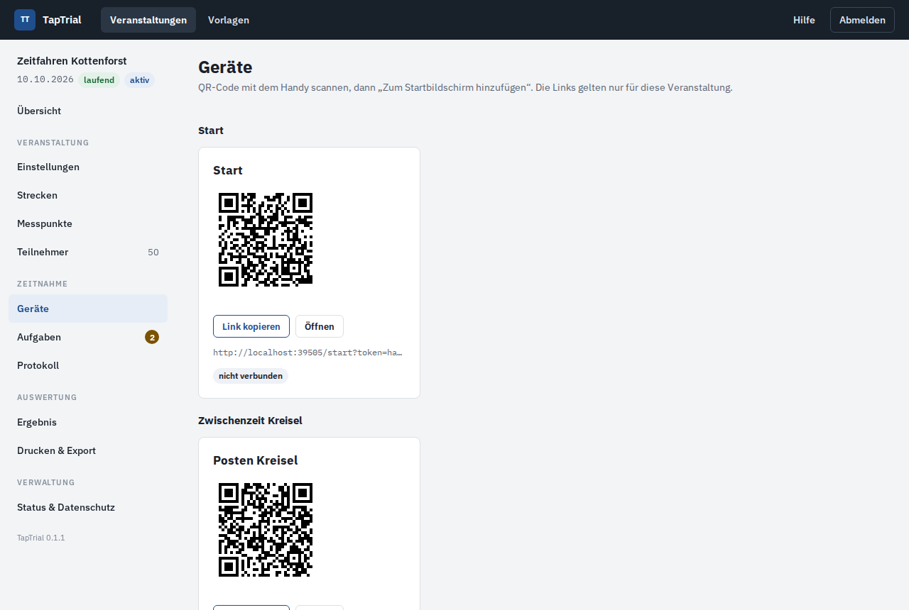

Auf der Seite „Geräte“ (und im letzten Schritt des Assistenten) stehen die Karten mit **QR-Code** **nach Messpunkt gruppiert**: je Start **Start** (weitere „Start <Name>“), je Zwischenzeit **„Posten <Name>“** mit den Strecken, die dort vorbeiführen (darf nur Durchfahrten an dieser Zwischenzeit erfassen), je Ziel **Ziel** und **Rennleitung** (weitere „Ziel <Name>“, „Rennleitung <Name>“), zuletzt unter „Öffentlich“ der **Zielmonitor** (ohne Token). Jeder Messpunkt hat eigene Links mit eigenem Token; der bisherige Start- und Ziel-Link gilt für die Standard-Messpunkte „Start“ und „Ziel“. Gibt es mehrere Starts bzw. Ziele, nennt die Karte deren Strecken. Ein Startgerät zeigt nur die Fahrer der Strecken, die an seinem Start beginnen, mit eigener Startfolge; ein Zielgerät in „Erfassen“ nur die Fahrer der Strecken, die an seinem Ziel enden (Rennleitung, Zielmonitor und Admin sehen alles). Messpunkte, die keine Strecke nutzt, haben keine Karte (auch nicht auf dem QR-Blatt); sobald eine Strecke sie wieder nutzt, ist die Karte mit demselben Link wieder da. „Als Nächstes“ in der Übersicht meldet genutzte Messpunkte ohne verbundenes Gerät, z. B. „Startgerät Nord noch nicht verbunden“. Alle Karten sind gleich aufgebaut: Titel, QR-Code, direkt darunter „**Link kopieren**“ und „**Öffnen**“, darunter der Link (gekürzt; vollständig beim Darüberfahren und beim Kopieren). Die Helfer scannen den QR-Code mit dem Handy und folgen ihrer Kurzanleitung. Mehrere Gerätelinks lassen sich im selben Browser öffnen (z. B. Ziel und Rennleitung auf einem Laptop oder zwei Posten zum Testen): Jeder Link ist ein eigenes Gerät mit eigener Kennung, eigenen nicht übertragenen Einträgen und eigenen Einstellungen. Zum Verteilen auf Papier: „Drucken & Export“ → „Gerätelinks mit QR-Codes“. Jede Karte zeigt, ob ihr Gerät **verbunden** ist (mit Uhrzeit der letzten Meldung). Karten und die Tabelle „Verbundene Geräte und Uhren“ aktualisieren sich alle 10 Sekunden selbst („Stand: hh:mm:ss“); ein Bereich, in dem du gerade etwas geöffnet, angeklickt oder geändert hast, bleibt dabei unberührt.

- Die Links gelten nur für **diese** Veranstaltung. Nach dem Abschließen sind alle Gerätelinks ungültig; die Handys löschen dann ihre Daten.
- **Ziel und Rennleitung** (auf der Karte des jeweiligen Ziels, bei mehreren Zielen je Karte): Standard ist „Ziel und Rennleitung auf einem Gerät umschaltbar“ (der Rennleitungs-Link ist der Ziel-Link mit `sicht=rennleitung`). Häkchen weg und „Speichern“: Die Rennleitung bekommt einen **eigenen Link mit eigenem Token**; der Ziel-Link zeigt dann nur „Erfassen“ und darf nur Einläufe erfassen (±1 s und Rückgängig am eigenen letzten Einlauf). Zuordnen, Umbuchen und Status gehen nur noch mit dem Rennleitungs-Link. Gibt es schon Zeiten, muss das Umschalten bestätigt werden – vorhandene Geräte brauchen dann neue Links. Bei mehreren Zielen gilt die Option je Ziel (eigenes Häkchen auf jeder Ziel-Karte).
- **Verbundene Geräte und Uhren:** je Gerätekennung (z. B. `ziel-3f2a`) Rolle (bei Posten mit Zwischenzeit, z. B. „Posten Kreisel“), letzte Meldung und Abweichung der Geräteuhr gegenüber dem Server (+ = Gerät geht nach). Über 0,5 s steht sie markiert mit „Gerät prüfen“ (auch in der Übersicht unter „Als Nächstes“). Vor dem Start müssen Start und Ziel unter 0,5 s liegen. Zeiten werden nicht korrigiert.
- **Zugang sperren:** Ist ein Link in falsche Hände geraten oder ein Handy verloren: „**Token erneuern …**“ und im Dialog bestätigen – je Messpunkt und Rolle ein Knopf (bei getrennter Rennleitung auch für den Rennleitungs-Link). Wird ein Messpunkt entfernt, ist sein Link sofort ungültig. Der alte Link funktioniert sofort nicht mehr; alle Geräte dieser Rolle brauchen den neuen Link.

## 7. Während des Rennens: Aufgaben, Korrekturen, Protokoll {#aufgaben}

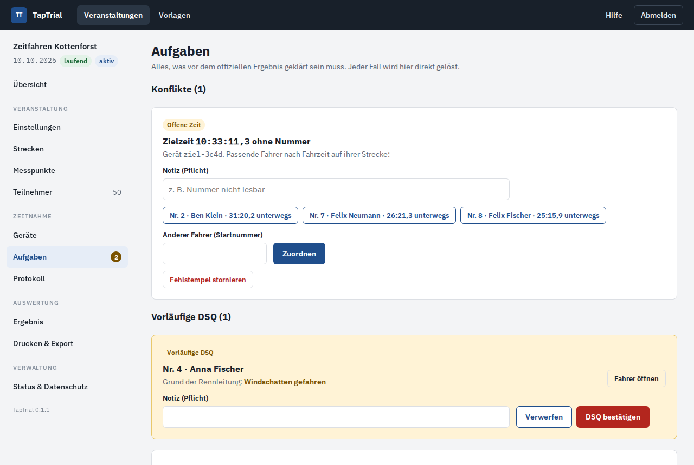

Die Seite „**Aufgaben**“ zeigt alles, was vor dem offiziellen Ergebnis geklärt sein muss – jeder Fall als eigene Karte, die sich direkt lösen lässt. Die Seitenleiste zeigt die Zahl offener Aufgaben. Jede **Korrektur** braucht eine Notiz und steht im Protokoll; nichts wird gelöscht.

- **Offene Zeit** (Zielzeit ohne Nummer): Die Karte schlägt passende Fahrer vor – unterwegs, sortiert nach ihrer erwarteten Ankunft (Start + Medianzeit der Strecke), mit der Zeit, die sie schon unterwegs sind. Notiz eintragen und den Vorschlag anklicken, oder „Anderer Fahrer“ mit Startnummer und „Zuordnen“. Ein Fehltipp lässt sich mit „Fehlstempel stornieren“ entfernen.
- **Mehrere Zielstempel / Startstempel** für einen Fahrer: Notiz eintragen und beim falschen Stempel „… stornieren“.
- **Stempel für unbekannte Startnummer:** richtige Nummer eintragen und „Umbuchen“.
- **Zielzeit vor Startzeit** und **keine Klasse:** Button zur Fahrer-Seite bzw. zu „Daten bearbeiten“.
- **Vorläufige DSQ:** Setzt die Rennleitung „DSQ vorläufig“, erscheint der Fall mit dem Grund. Der Fahrer bleibt bis dahin mit Zeit und Rang „unter Vorbehalt“ (gelb). **DSQ bestätigen** (Notiz) → disqualifiziert (rot, ohne Rang und Abzeichen); **Verwerfen** (Notiz) → normal gewertet.
- **Segmente erzeugen keine Aufgaben:** Fehlt eine Durchfahrt, gibt es ab dort für diesen Fahrer keine Segmentzeiten mehr; Doppeltipps (gleiches Gerät, gleicher Fahrer, unter 10 s) verwirft die Auswertung selbst. Beides berührt Gesamtzeit und Rang nie.
- **Hinweise** (z. B. unplausible Fahrzeit) blockieren nicht; „Fahrer öffnen“ zum Prüfen.
- **Sonderfälle:** „**Zeiten zweier Fahrer tauschen**“ (z. B. wenn am Ziel zwei Nummern verwechselt wurden) und ein Button zu „**Gerätedatei einlesen**“.

Alles, was nur **einen** Fahrer betrifft – Stempel umbuchen oder stornieren, manuelle Zeit, Status DNS/DNF/DSQ/OK – steht auf der **Fahrer-Seite** (Abschnitt 4a).

**Schnellkorrektur am Ziel:** Zielrichter und Rennleitung können eine Zielzeit in Schritten von 1 s verschieben (höchstens ±5 s je Einlauf; ältere Korrekturen in 0,2-s-Schritten bleiben gültig). Der Zielrichter kann seinen letzten Einlauf außerdem direkt zurücknehmen („Rückgängig“, steht als Storno im Protokoll). Jeder Tipp steht als „Zeitkorrektur“ im Protokoll; Ergebnis-Tabelle, Fahrer-Seite, Protokoll und Ergebnis-CSV kennzeichnen die Zeit als „korrigiert (+0,4 s)“. Die Korrektur bleibt beim Umbuchen am Einlauf. Größere Abweichungen: manuelle Zeit eintragen.

**Startgerät:** zwei Umschalter je Handy: „Nummer wählen“ (Standard an) und „Warteliste anzeigen“ (Standard aus, nur Anzeige). Die laufende Uhrzeit auf den Geräten zeigt nur hh:mm:ss; gemessene Zeiten bleiben in Zehnteln.

### Protokoll {#protokoll}

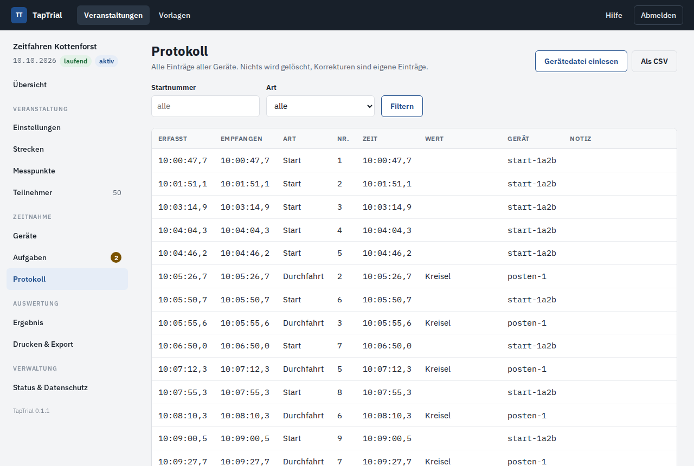

Das **Protokoll** zeigt alle Einträge mit Notiz, filterbar nach Startnummer und Art (Start, Ziel, Korrekturen, Status, Ergebnis und Merkmale, Durchfahrten); stornierte sind durchgestrichen. Oben: „Gerätedatei einlesen“ und „Als CSV“.

**Durchfahrten (Segmente):** Tipps, die für die Segmentzeiten nicht zählen, tragen „nicht gezählt: Doppeltipp“ (gleiches Gerät, gleicher Fahrer, unter 10 s), „nicht gezählt: am Ziel“ (Tipp innerhalb 10 s um die Zielzeit, z. B. Zwischenzeit auf der Ziellinie) oder „nicht in der Abfolge“. Ein Doppeltipp lässt sich mit **„Doch werten“** (Notiz Pflicht) zurücknehmen,

**Gerätedatei einlesen:** Kommt ein Handy nicht mehr ins Netz, auf dem Handy „Gerät zurücksetzen“ (zweimal tippen) → „Einträge exportieren“ und die Datei zum Laptop schicken. Unter „Protokoll“ (oder „Aufgaben“ → „Sonderfälle“) → „Gerätedatei einlesen“ die Datei wählen → „Vorschau“: Anzahl der Einträge, davon schon vorhanden (gleiche UUID, z. B. doch schon übertragen), neu und ungültig. Gehört die Datei zu einer anderen Veranstaltung, erscheint eine Warnung; übernommen wird dann nur nach Ankreuzen. „Übernehmen“ legt nur die neuen Einträge an, mit der Gerätekennung aus der Datei – mehrfaches Einlesen schadet nicht. Im Protokoll steht bei diesen Einträgen „aus Datei übernommen“ (Zeitpunkt im Tooltip und in der Protokoll-CSV). Geht nur, solange die Veranstaltung läuft – also **vor** dem Abschließen.

## 8. Ergebnis offiziell erklären {#ergebnis}

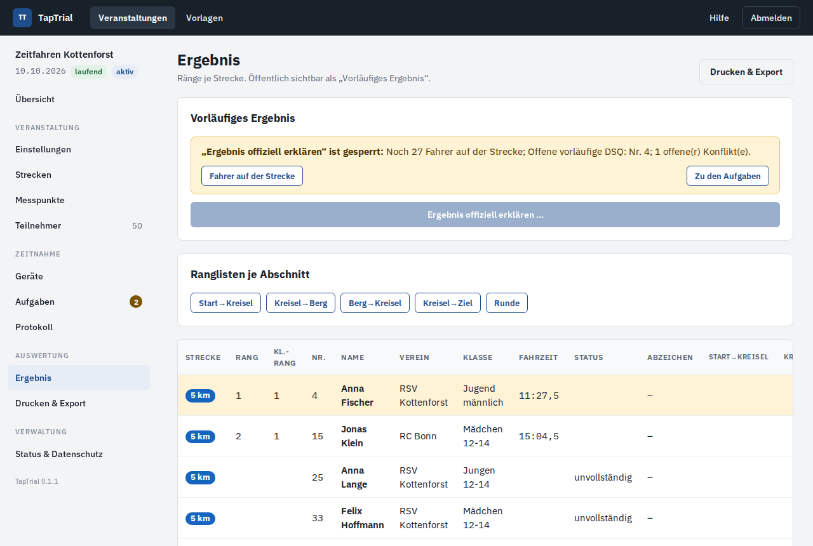

Auf der Seite „Ergebnis“ steht die Ergebnistabelle (ein Klick auf eine Zeile öffnet den Fahrer, „Urkunde“ druckt eine einzelne). Solange es vorläufig ist, heißt es überall „Vorläufiges Ergebnis“. Wenn alles geprüft ist: „**Ergebnis offiziell erklären …**“ und im Dialog bestätigen (Notiz optional). Das geht erst, wenn **alle gestarteten Fahrer durch sind** (Zielzeit oder DNF/DSQ) und keine vorläufigen DSQ und keine Konflikte mehr offen sind – sonst ist der Button gesperrt, die Seite nennt den Grund (z. B. „Noch 3 Fahrer auf der Strecke“) und bietet „Fahrer auf der Strecke“ (gefilterte Teilnehmerliste) bzw. „Zu den Aufgaben“. Erst dann erscheint der Punkt auch in „Als Nächstes“. Danach steht überall „Offizielles Ergebnis, Stand hh:mm“. Bei einem Einspruch: „Zurücknehmen …“ mit Notiz – das Ergebnis ist wieder vorläufig.

Mit **Segmenten** (Abschnitt 5a.3) hat die Tabelle je sichtbarem Auswertungsabschnitt und Durchfahrt eine Spalte (z. B. „Start→Kreisel“, „Kreisel→Berg (1)“ … „Kreisel→Ziel“; „–“ = nicht vorhanden, z. B. ab einer fehlenden Durchfahrt). Nutzen mehrere Strecken Segmente, steht der Streckenname davor. Segmentzeiten zählen nicht für Rang und Gesamtzeit.

**Ranglisten je Abschnitt:** Unter „Ranglisten je Abschnitt“ ein Button je sichtbarem Abschnitt (z. B. „Runde“). Er zeigt die Rangliste dieses Abschnitts je Strecke nach der **schnellsten Durchfahrt** jedes Fahrers (mit Bezeichnung der Durchfahrt, z. B. „Runde (2)“); gleiche Zeit = gleicher Rang, a. K. ohne Rang, DSQ nicht gewertet, DNF mit den gemessenen Durchfahrten gewertet. „Als CSV“ lädt sie herunter.

## 9. Drucken & Export {#drucken}

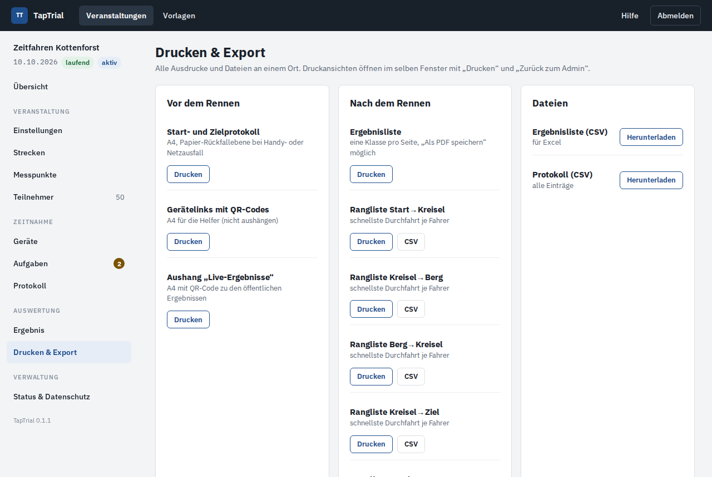

Alle Ausdrucke und Dateien stehen auf der Seite „**Drucken & Export**“:
- *Vor dem Rennen:* **Start- und Zielprotokoll** (Liste nach Startnummer mit leeren Spalten „Uhrzeit Start“/„Uhrzeit Ziel“, 10 leeren Zeilen für Nachmeldungen, Kopf auf jeder Seite und Seitenzahl – Rückfallebene bei Handy- oder Netzausfall; Zeiten danach als manuelle Zeit eintragen), **Gerätelinks mit QR-Codes** (A4-Blatt mit Start, Ziel, Rennleitung und Zielmonitor für die Helfer – enthält Zugangslinks, nicht aushängen), **Aushang „Live-Ergebnisse“** (großer QR-Code zu `/ergebnisse`, immer die aktive Veranstaltung; derselbe QR-Code steht klein auf dem Zielmonitor).
- *Nach dem Rennen:* **Ergebnisliste** (eine Klasse pro Seite; im Browser „Drucken“ → „Als PDF speichern“), **Urkunden**.
- *Dateien (Export):* **Ergebnisliste (CSV)** – für Excel; **Protokoll (CSV)** – alle Einträge.
- *Ranglisten je Abschnitt:* unter „Nach dem Rennen“ je Abschnitt „Drucken“ und „CSV“ (öffentlich und im Druck nur mit „Zwischenzeiten öffentlich“). Öffentlich wählt man sie auf `/ergebnisse` über „Ranglisten Abschnitte“.
- *Segmente:* Ergebnisliste (Druck), öffentliche Ergebnisse und öffentliche CSV haben die Spalten je Segment-Durchfahrt nur, wenn „Zwischenzeiten öffentlich“ an ist; die CSV aus dem Admin hat sie immer. Was der Zielmonitor zeigt, steht unter Einstellungen → Öffentlichkeit & Zielmonitor (Abschnitt 5.2).

Druckansichten öffnen im selben Fenster. Oben steht eine Leiste mit „**Drucken**“ und „**Zurück zum Admin**“ (zurück zur Seite, von der man kam); beim Drucken ist sie ausgeblendet.

**Urkunden:** eine Druckansicht (A4 quer, eine Urkunde je Seite) für alle Fahrer mit gültiger Zeit; „Urkunde“ in der Ergebnistabelle oder auf der Fahrer-Seite druckt eine einzelne. Inhalt: Veranstaltung, Datum, Name, Strecke mit gemessener Länge, Klasse, Platz in der Klasse (bei a. K. „außer Konkurrenz“), Fahrzeit, ggf. Gold/Silber/Bronze, Unterschriftszeile. Keine Urkunden bei DNS, DNF, DSQ (auch vorläufig) und Konflikt. Solange das Ergebnis vorläufig ist, trägt jede Urkunde das Wasserzeichen „vorläufig“. **Die Urkunde ersetzt nicht den offiziellen Nachweis für das Deutsche Radsportabzeichen** (dafür braucht es weiter Prüfer und Unterschrift).

Öffentlich ohne Anmeldung: Ergebnisse unter `/ergebnisse` (mit Druckansicht und CSV), Zielmonitor unter `/monitor` (quer und hochkant nutzbar, siehe [Kurzanleitung Zielmonitor](MONITOR.md)).

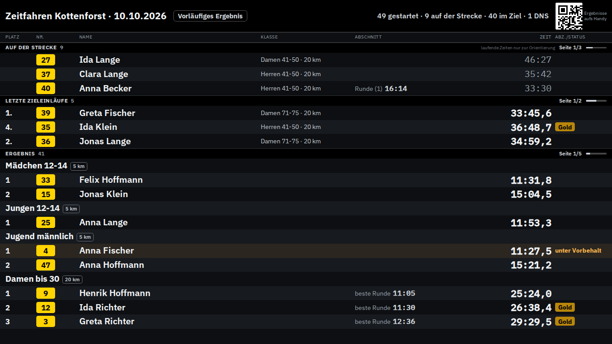

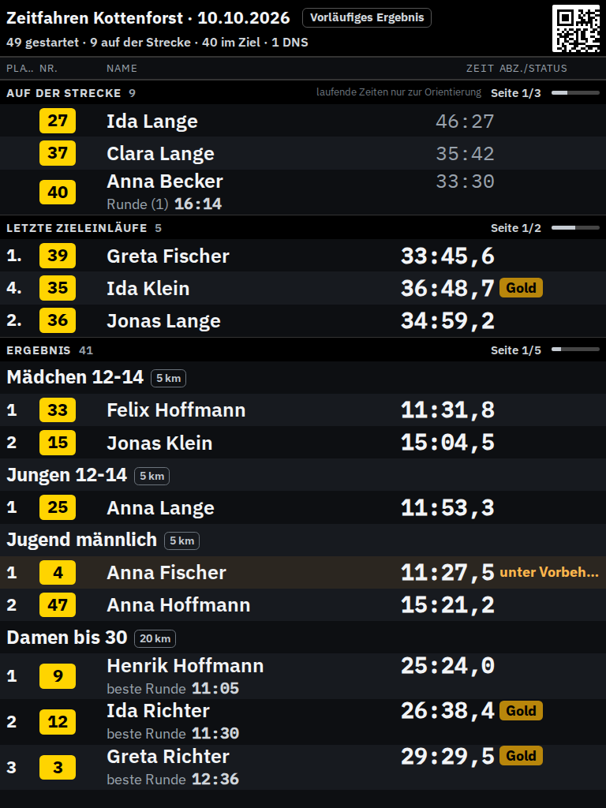

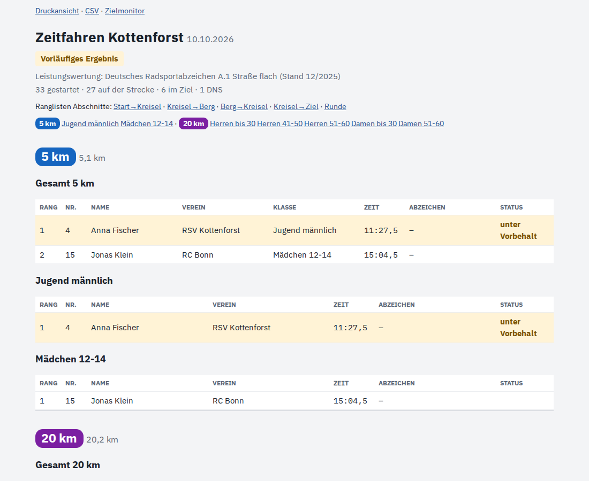

## 10. Status & Datenschutz: abschließen, anonymisieren, löschen {#status}

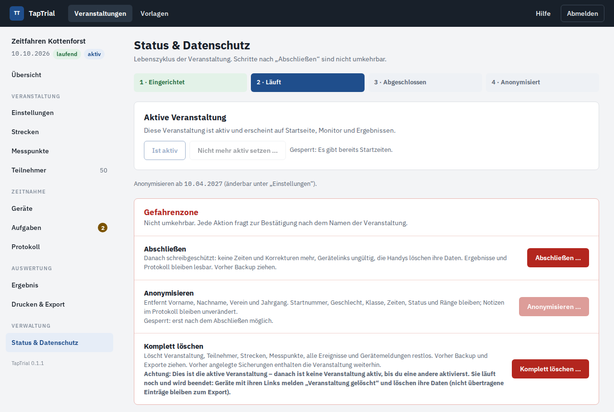

Die Seite „**Status & Datenschutz**“ zeigt oben den Stand im Lebenszyklus (Eingerichtet → Läuft → Abgeschlossen → Anonymisiert), darunter „Aktive Veranstaltung“ (aktiv setzen mit Bestätigungsdialog – erst nach abgeschlossener Einrichtung, sonst gesperrt mit Grund und „Einrichtung fortsetzen“; hat die aktive Veranstaltung Startzeiten und ist nicht abgeschlossen, ist es gesperrt mit „‚<Name>‘ läuft (Startzeiten vorhanden). Erst abschließen.“ und einem Button zur laufenden Veranstaltung) und die **Gefahrenzone**. Ist sie aktiv, gibt es „**Nicht mehr aktiv setzen …**“ (Dialog) – nur solange es noch keine Startzeit gibt, sonst gesperrt mit „Es gibt bereits Startzeiten.“; danach sind die Geräte wieder gesperrt. Jede Aktion der Gefahrenzone ist nicht umkehrbar und fragt nach dem **Namen der Veranstaltung**; was im Zustand noch nicht geht, ist gesperrt und nennt den Grund.
- **Abschließen** (nach dem Rennen, nach dem Backup): „Abschließen …“, Namen eintippen, „Abschließen“. Danach ist alles schreibgeschützt, die Gerätelinks sind ungültig, Ergebnisse und Exporte bleiben verfügbar. Die Helfer öffnen ihre App noch einmal – sie löscht dann die Daten auf dem Handy.
- **Anonymisieren** (nach der Frist, Standard 6 Monate nach dem Datum; Übersicht und Liste zeigen „Anonymisierung fällig“): entfernt Namen, Vereine und Jahrgänge; Startnummer, Klasse, Zeiten und Ränge bleiben. Erst nach dem Abschließen. Es wird nie automatisch anonymisiert. Die Frist lässt sich unter „Einstellungen“ ändern.
- **Komplett löschen:** löscht Veranstaltung, Teilnehmer, Strecken, Messpunkte, alle Zeiten und Korrekturen, Gerätemeldungen, Zielmonitor-Einstellungen und Importentwürfe **restlos**; andere Veranstaltungen bleiben unberührt. Vorher Exporte ziehen. Vorher angelegte Sicherungen enthalten die Veranstaltung weiterhin. Ist sie die aktive oder läuft sie noch, wird sie dabei beendet: danach ist **keine** Veranstaltung aktiv, bis du eine andere aktivierst, und die Geräte mit ihren Links melden „Diese Veranstaltung gibt es nicht mehr“ und löschen ihre Daten (nicht übertragene Einträge bleiben zum Export).

Der Unterschied auf einen Blick:
- **Abschließen** (nach dem Rennen, nach dem Backup): Daten bleiben schreibgeschützt, Ergebnisse/Exporte weiter da; Geräte melden „Veranstaltung beendet“ und räumen auf.
- **Löschen** (Test- oder Fehlanlage, nach der Anonymisierungsfrist): alles weg; Geräte melden „Diese Veranstaltung gibt es nicht mehr“ und räumen auf.
- **Token erneuern** (Link verloren oder in falschen Händen, unter „Geräte“): Daten bleiben, Rennen läuft weiter; Geräte mit altem Link zeigen „Zugangstoken ungültig“ und räumen **nicht** auf.

### Impressum & Datenschutz {#rechtliches}

Unter Vorlagen → *Installation* → **Impressum & Datenschutz**, einmal für die ganze Installation: je Seite entweder ein **Link** (https, z. B. auf die Seiten des Vereins) oder ein **Text** (Leerzeile = neuer Absatz; die App zeigt ihn unter `/impressum` bzw. `/datenschutz`). Die Links stehen klein in der Fußzeile der Startseite, der Ergebnisse, der Druckansicht der Ergebnisse und der Hilfe – nicht auf dem Zielmonitor. Fehlt etwas, erinnert die Übersicht einer **aktiven** Veranstaltung unten in „Als Nächstes“ daran (dezent, keine Aufgabe).

### Öffentliche Daten {#oeffentliche-daten}

Als Grundlage für eure eigene Datenschutzerklärung – sachlich, keine Rechtsberatung:
- **Öffentlich ohne Anmeldung** (Startseite, Ergebnisse mit Druck und CSV, Zielmonitor): Name und Datum der aktiven Veranstaltung; je Teilnehmer Startnummer, Vor- und Nachname, Verein, Klasse (lässt auf Altersgruppe und Geschlecht schließen), Strecke, Fahrzeit, Platz, Status (DNS/DNF/DSQ, „unter Vorbehalt“, „a. K.“), ggf. Abzeichen; auf dem Zielmonitor die laufende Zeit seit dem Start. Abschnitts- und Rundenzeiten nur, wenn „Zwischenzeiten öffentlich“ an ist (Ranglisten-Seiten des Monitors zeigen sie immer).
- **Nicht öffentlich**, nur im Admin: Jahrgang, Geschlecht, Merkmale, das Protokoll aller Ereignisse mit Notizen, Gerätekennungen und Uhrabweichungen der Helfer-Geräte.
- **Speicherung:** alles in einer Datenbank auf eurem Server; keine Dienste Dritter, keine Werbung, keine Analyse, Schriften lokal. Der Admin setzt nach der Anmeldung ein Sitzungs-Cookie; Helfer-Geräte speichern ihre Zeiten und Einstellungen im Browser (für den Offline-Betrieb), bis die Veranstaltung beendet ist.
- **Löschen:** Anonymisieren entfernt Namen, Vereine und Jahrgänge (Frist standardmäßig 6 Monate, nie automatisch), „Komplett löschen“ entfernt eine Veranstaltung restlos (Abschnitt 10). Sicherungen eures Servers enthalten die Daten weiter.

## 11. Typische Fehler {#fehler}

- **„Importieren“ bleibt grau:** In der Vorschau sind noch Fehler (rote Zellen). „nur fehlerhafte Zeilen“ ankreuzen, korrigieren oder Zeilen löschen (Abschnitt 4).
- **„keine Altersklasse für Geschlecht …, Alter …“:** Geburtsjahr prüfen (Klassen ab 8 Jahren).
- **Helfer sieht „Zugangstoken ungültig“:** Falscher oder erneuerter Link: aktuellen Link unter „Geräte“ geben.
- **Helfer sieht „Keine aktive Veranstaltung“:** Veranstaltung aktivieren (Abschnitt 3).
- **Helfer sieht „Zeitnahme noch nicht freigegeben“:** Einrichtung abschließen und die Veranstaltung aktiv setzen (Übersicht → „Als Nächstes“ bzw. „Geräte“ haben je einen Button dorthin). Das Gerät schaltet sich danach von selbst frei; was es vorher schon erfasst hatte, sendet es dann.
- **Zielzeit fehlt:** Handstoppuhr/Video: auf der Fahrer-Seite als manuelle Zeit eintragen (Abschnitt 4a).
- **„Ergebnis offiziell“ geht nicht:** Grund steht unter „Ergebnis“; „Zu den Aufgaben“ führt zu den offenen Fällen.
- **Abzeichen fehlen („–“):** Hat der Teilnehmer „Abzeichen: ja“ (Fahrer-Seite)? Leistungswertung, Strecke seiner Klasse und deren Länge prüfen (Abschnitt 5); bei DNF/DSQ/Konflikt gibt es keine Stufe.
- **Jugendliche in der 20-km-Liste:** Zuordnung der Klasse unter „Einstellungen“ prüfen (vor der ersten Zeit änderbar).
- **Klassensatz lässt sich nicht ändern:** Die Veranstaltung hat schon Zeiten und ist eingefroren (Abschnitt 5).
- **Satz lässt sich nicht löschen:** Er wird noch von einer Veranstaltung oder einem Wertungssatz verwendet (die Liste zeigt, von wem).
- **Fahrer ohne Rang mit „a. K.“:** fährt außer Konkurrenz (Abschnitt 4) – gewollt, sonst auf der Fahrer-Seite umschalten.
- **Wertung nach Klassensatzwechsel weg:** Der Wertungssatz gehört zu einem anderen Klassensatz und wurde zurückgesetzt – passenden Wertungssatz wählen (Abschnitt 5).
- **Anmeldung gesperrt:** 15 Minuten warten.

## 12. Vorlagen: Klassen- und Wertungssätze verwalten {#vorlagen}

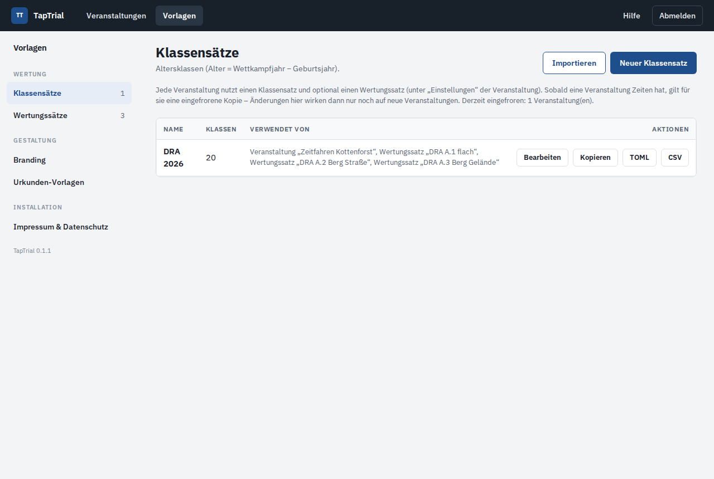

Oben im Admin „**Vorlagen**“. Links steht eine Seitenleiste wie in einer Veranstaltung: Gruppe *Wertung* mit **Klassensätze** und **Wertungssätze**, Gruppe *Gestaltung* mit **Branding** (Vereinsname, siehe unten) und **Urkunden-Vorlagen** (noch ohne Funktion). Mitgeliefert sind „DRA 2026“ (Altersklassen) und die Wertungssätze „DRA A.1 flach“, „DRA A.2 Berg Straße“ und „DRA A.3 Berg Gelände“. Je Satz: „Bearbeiten“, „Kopieren“, Export als „TOML“ oder „CSV“ und – wenn nicht verwendet – „Löschen“ (mit Bestätigungsdialog). Ein Klick auf die Zeile öffnet den Satz.

- **Neu / Bearbeiten:** „Neuer Klassensatz“ bzw. „Neuer Wertungssatz“ oben auf der jeweiligen Liste. Die Klassen bzw. Stufen stehen als Tabelle; Zeilen ändern, „Entfernen“ ankreuzen, „Speichern“. Im Klassensatz unten leere Zeilen ausfüllen.
- **Wertungssatz:** gehört fest zu **einem Klassensatz** (Pflichtfeld). Die Klasse je Zeile wählt man aus einer Liste, die nur Klassen ohne Eintrag anbietet; „Zeile hinzufügen“ ergänzt eine Zeile. Haben alle Klassen einen Eintrag, ist der Knopf grau und es erscheint „Alle Klassen haben einen Eintrag“.
- **Kopieren:** am einfachsten einen mitgelieferten Satz kopieren und anpassen.
- **Löschen:** nur, wenn der Satz von keiner Veranstaltung (und als Klassensatz von keinem Wertungssatz) verwendet wird.
- **Export/Import:** TOML (bisheriges Dateiformat aus `config/`) oder CSV; „Importieren“ oben rechts öffnet eine eigene Seite. Groß-/Kleinschreibung ist beim Import egal. CSV-Spalten Klassensatz: `name;geschlecht;alter_von;alter_bis`; Wertungssatz: `klasse;strecke_km;gold;silber;bronze` (Art und Streckengrenzen gibt man beim CSV-Import im Formular an).

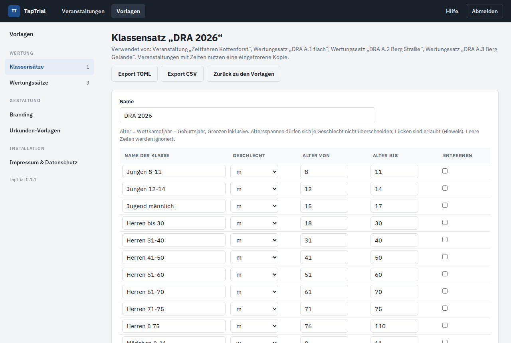

Beim Speichern wird geprüft:
- Klassensatz: Name eindeutig, Geschlecht m/w/d, Altersspannen je Geschlecht **ohne Überschneidung** (sonst Fehler). **Lücken** (ein Alter ohne Klasse) sind erlaubt und erscheinen als Hinweis.
- Wertungssatz: Gold < Silber < Bronze je Klasse, Art „Gesamtzeit“ (H:MM:SS, je Klasse Streckenlänge) oder „Zeit pro km“ (M:SS, Strecke min–max). Die Klassen müssen im zugeordneten Klassensatz vorkommen (sonst Fehler, auch beim Speichern der Veranstaltung und beim Einfrieren). Klassen ohne Stufen werden als Hinweis genannt. Der Klassensatz eines Wertungssatzes lässt sich nicht wechseln, solange eine noch nicht eingefrorene Veranstaltung ihn mit dem alten Klassensatz nutzt.

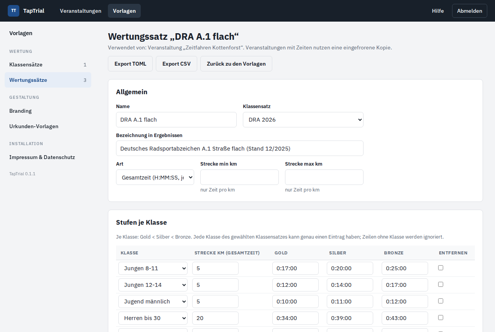

### Branding: Vereinsname {#branding}

„**Vorlagen**“ → *Gestaltung* → „**Branding**“. Ein Feld „Vereinsname“ für die ganze Installation (gilt für alle Veranstaltungen, einmal eintragen). Ist er gesetzt, steht er **vorn**: Startseite (groß über der Veranstaltung), Kopf der öffentlichen Ergebnisse („Verein · Veranstaltung“), Admin-Kopf (Kürzel und Name, „TapTrial“ klein darunter), Zielmonitor-Kopfleiste, Druckansichten (Ergebnisliste, Aushang, Start-/Zielprotokoll, Gerätelinks), Urkunden (statt des Logo-Platzhalters) und Seitentitel im Browser-Tab. „TapTrial“ steht dann nur noch klein in Fußzeilen und als Zusatz im Seitentitel. Leer: überall neutral „TapTrial“. Die Änderung gilt sofort nach „Speichern“ – auch ein offener Zielmonitor übernimmt sie beim nächsten Abruf. Solange eine Veranstaltung aktiv ist und kein Vereinsname eingetragen ist, erinnert die Übersicht dezent unter „Als Nächstes“ daran. Ein Logo lässt sich noch nicht hochladen (Roadmap).

Änderungen an einem Satz wirken auf alle Veranstaltungen, die ihn nutzen und **noch keine Zeiten** haben. Veranstaltungen mit Zeiten behalten ihre eingefrorene Kopie.
