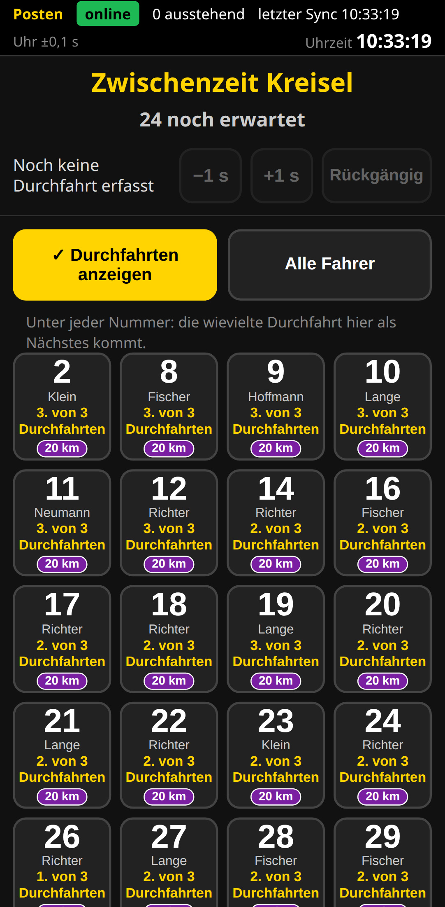

# Kurzanleitung Posten (Zwischenzeit)

## Vorbereiten
1. Den **Posten-Link** öffnen bzw. den QR-Code deiner Zwischenzeit scannen (vom Veranstalter, jede Zwischenzeit hat einen eigenen).
2. Im Browser-Menü **„Zum Startbildschirm hinzufügen“** und die App danach immer über dieses Symbol öffnen.
3. Oben steht „Zwischenzeit“ mit dem **Namen deines Messpunkts** und „online · 0 ausstehend“; die Uhr muss „Uhr ±0,…“ unter 0,5 s zeigen (sonst Rennleitung fragen). Steht **„Zeitnahme noch nicht freigegeben“** da: warten – der Veranstalter schaltet frei, die Seite geht dann von selbst weiter.

## Normaler Ablauf
- Jeder erwartete Fahrer (aller Strecken, die hier vorbeiführen; bei mehreren mit Streckenkennzeichen) hat eine **Kachel** mit Startnummer und – wenn er mehrmals vorbeikommt – z. B. „**2. von 3 Durchfahrten**“: die Durchfahrt, die hier als Nächstes kommt. Wurde ein Klick vergessen (auch an einem anderen Posten), springt die Anzeige weiter, sobald seine nächste Zeit eingeht. Umschalter „**Durchfahrten anzeigen**“ (Standard an): aus = nur die Nummer; das Handy merkt sich die Stellung.
- Fährt er vorbei: **Kachel einmal antippen**. Die Kachel zeigt danach die nächste Durchfahrt und verschwindet nach der letzten.
- Darunter steht deine **letzte Durchfahrt**: „−1 s“ / „+1 s“ (zu spät/früh getippt, höchstens ±5 s), **„Rückgängig“** (falscher Fahrer, zweimal tippen).
- Ausgegraute Kacheln: noch nicht gestartet. Sie lassen sich trotzdem antippen.

## Sonderfälle
- **Fahrer fehlt, kommt aber gerade:** „**Alle Fahrer**“ einschalten – dann stehen auch Fahrer da, die hier schon als vorbei gelten („gilt als vorbei“, z. B. nach einem Fehlklick an einem anderen Posten); antippen zählt normal.
- **Fahrer verpasst:** nicht nachtragen – eine fehlende Durchfahrt hat **keine Folgen** für die Wertung (Anzeige „–“).
- **Unsicher, welcher Fahrer:** lieber nicht tippen – eine fehlende Durchfahrt schadet nicht, ein falscher Tipp verfälscht Segmentzeiten.
- **Kein Netz:** weitermachen, alles wird gespeichert und später gesendet.
- **Zwischenzeit auf der Ziellinie:** auch beim Zieleinlauf ruhig tippen – dieser Tipp zählt nicht doppelt.
- **Doppeltipp:** Ein zweiter Tipp innerhalb einer Sekunde wird ignoriert; zwei Tipps desselben Fahrers innerhalb von 10 s wertet die Auswertung automatisch als einen.

## Nach dem Rennen
1. Warten, bis **0 ausstehend** steht.
2. Nach dem Abschluss die App **einmal öffnen** („Veranstaltung beendet – Daten auf diesem Gerät gelöscht“).
3. Bei „**N Einträge nicht übertragen**“: „Einträge exportieren“ und an die Rennleitung schicken. Meldet ein neuer Link „**N Einträge einer früheren Veranstaltung**“: „Als Datei sichern“ – sie gehen nicht an die neue.
