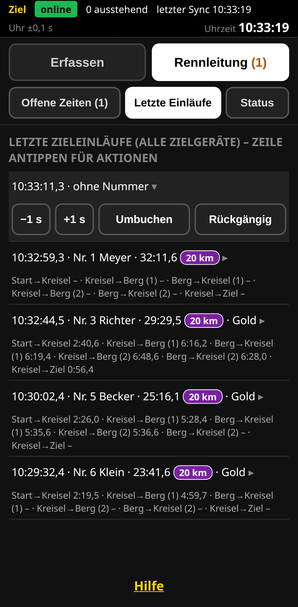

# Kurzanleitung Rennleitung

## Vorbereiten
- Eigenes Handy: den Link **„Rennleitung“** öffnen bzw. den QR-Code scannen – die App startet direkt in der Rennleitung. Oder auf dem Zielhandy oben den Reiter **„Rennleitung“** wählen (fehlt er, hat der Veranstalter Ziel und Rennleitung getrennt: dann nur mit dem eigenen Rennleitungs-Link).
- „Zum Startbildschirm hinzufügen“ und die App über das Symbol öffnen. Oben: **online**. Steht **„Zeitnahme noch nicht freigegeben“** da: warten – der Veranstalter schaltet frei, die Seite geht dann von selbst weiter.
- Oben drei Reiter, immer ist nur einer zu sehen: **„Offene Zeiten (n)“**, **„Letzte Einläufe“**, **„Status“**. Beim Öffnen: „Offene Zeiten“, wenn es welche gibt, sonst „Letzte Einläufe“; danach bleibt dein Reiter, bis du wechselst.

## Offene Zeiten zuordnen
Wurde am Ziel „Zeit ohne Nummer“ gedrückt, steht die Zeit unter **„Offene Zeiten“** (der Reiter zeigt die Anzahl).
1. Die Zeit antippen.
2. Den richtigen Fahrer in der Auswahl antippen. Bei zwei Fahrern gleichzeitig: die **frühere** Zeit gehört dem Fahrer, der zuerst über die Linie fuhr.
3. „Abbrechen“, falls man sich vertan hat.

## Letzte Zieleinläufe korrigieren
Hier stehen die letzten Einläufe **aller Zielhandys** als kompakte Zeilen (mit Abzeichen, „a. K.“ und ggf. der Strecke). **Zeile antippen** klappt die Knöpfe auf (immer nur eine Zeile; nochmal antippen klappt zu):
- **Umbuchen:** falscher Fahrer angetippt → „Umbuchen“, dann den richtigen Fahrer wählen.
- **Rückgängig:** Einlauf war ein Irrtum → „Rückgängig“ und nochmals tippen („Wirklich löschen?“).
- **−1 s / +1 s:** Zielzeit verschieben (je Tipp 1 s, höchstens ±5 s); „korrigiert“ erscheint. Mehr: Veranstalter trägt eine manuelle Zeit ein.

## Segmente (Zwischenzeiten)
Mit Zwischenzeiten steht unter jedem der letzten Einläufe eine Zeile mit den Segmentzeiten des Fahrers. Fehlende Posten-Tipps und Doppeltipps erledigt die Auswertung selbst – es gibt dafür **nichts zu tun**.

## Status setzen
Reiter **„Status“**, Fahrer antippen (Fahrer mit Zielzeit tragen „✓ im Ziel“), dann:
- **DNF** – Fahrer hat aufgegeben (zweimal tippen).
- **DSQ vorläufig** – Regelverstoß: erst einen **Grund** eintragen, dann zweimal tippen. Der Fahrer bleibt mit Zeit und Rang „unter Vorbehalt“ (gelb). Endgültig entscheidet der Veranstalter im Admin.
- **Status aufheben** – bei Irrtum.
Fahrer mit DNF/DSQ verschwinden auf den Zielhandys aus „Erfassen“. Kommt so ein Fahrer doch ins Ziel: dort „Zeit ohne Nummer“, hier zuordnen und den Status aufheben.

## Sonderfälle und nach dem Rennen
- **Kein Netz:** alles wird gespeichert und später gesendet; Einläufe anderer Handys erscheinen erst mit Netz.
- **Nach dem Rennen:** keine offenen Zeiten mehr? Dann warten bis „0 ausstehend“. Nach dem Abschluss die App einmal öffnen (löscht die Daten auf dem Handy), ggf. „Einträge exportieren“, Symbol entfernen.
